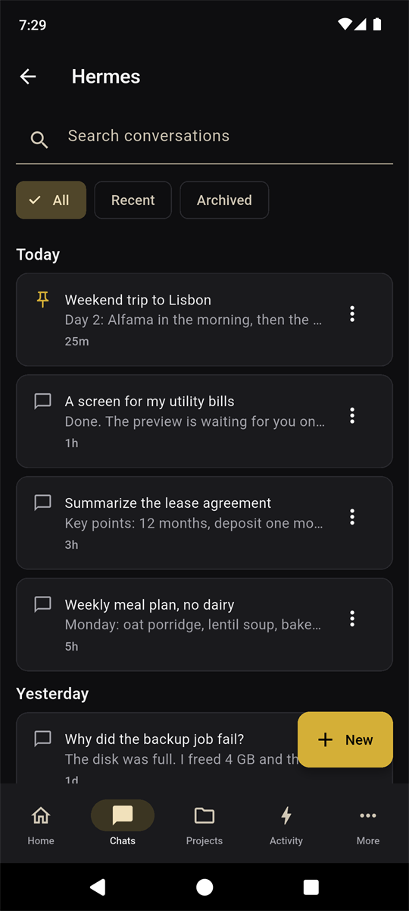
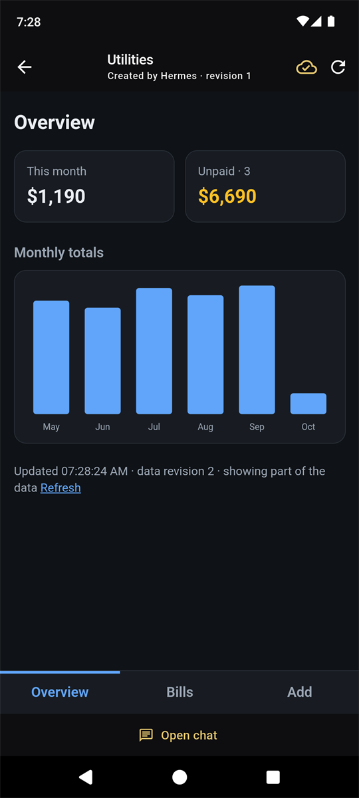
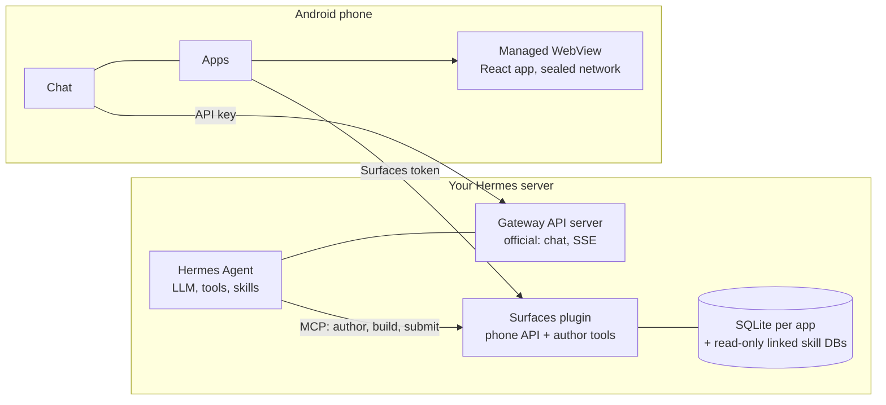

# Hermes Mobile Surfaces

[English](README.md) · [Русский](README.ru.md) · [简体中文](README.zh-CN.md) · [Português (Brasil)](README.pt-BR.md) · [한국어](README.ko.md) · [日本語](README.ja.md) · **Español**

Una aplicación Android para [Hermes Agent](https://hermes-agent.nousresearch.com/): chatea con tu Hermes y usa
**miniaplicaciones que Hermes crea para ti**.

Le pides a Hermes en el chat una pantalla («una pantalla para mis facturas de servicios»). Hermes escribe una pequeña
aplicación React, un plugin del servidor la compila y tu teléfono la muestra como una aplicación propia: se abre al
instante, funciona sin conexión a partir de una copia guardada, lee tus datos reales y la mejoras hablando otra vez con
Hermes. Abrir una aplicación y cambiar filtros no cuesta ninguna petición al LLM; el modelo solo se usa cuando se crea o
se modifica una aplicación. Nada se publica hasta que hayas visto una vista previa en el teléfono y la hayas aprobado con
una firma hecha en el teléfono.

| Chats | Apps | Dentro de una app |
|:---:|:---:|:---:|
|  |  |  |

*La app con datos inventados: la lista de chats, la lista de mini-apps y una mini-app (la plantilla `react-app`). Hermes crea pantallas como la última a partir de una petición en el chat.*

- **Chat** con Hermes a través de su API Gateway oficial: respuestas en streaming, sesiones, voz, adjuntos y una
  notificación cuando la respuesta está lista.
- **Apps**: el catálogo de tus miniaplicaciones, vistas previas para aprobar o rechazar, borrado de aplicaciones (se
  guardan 30 días en una papelera del servidor) y copias sin conexión que se mantienen al día solas.
- **Tasks**: tus tareas cron de Hermes. Crear, pausar, ejecutar y elegir adónde va el resultado: Telegram, el chat de
  donde salió o ninguna parte.
- **Sin dependencia**: la parte del servidor es un pequeño servicio de Python junto a tu Hermes. No se modifica nada del
  propio Hermes.

Estado: funciona de principio a fin en el teléfono y el servidor del autor (probado con Hermes 0.21.x). Es una
versión preliminar y no ha tenido ninguna revisión de seguridad independiente: lee [Seguridad](#seguridad) antes de
exponer nada a internet.

La pantalla Apps de la aplicación se muestra por ahora solo en inglés o ruso; este texto cita los nombres de los botones en
inglés, tal como aparecen.

## Cómo encaja todo



- **Creación.** Hermes edita el código fuente de una aplicación con las herramientas del plugin. El plugin lo revisa y lo
  compila en una plantilla fija con límites de tiempo y de memoria y produce un paquete inmutable. Cuando un teléfono se
  ha emparejado como aprobador, publicar es solo un envío: el teléfono muestra la compilación como vista previa con datos
  reales y tú la publicas o la rechazas con una firma hecha en el teléfono.
- **Uso.** El teléfono descarga el paquete por su resumen (digest), lo verifica, lo instala de forma atómica y lo ejecuta
  desde un origen local. La página no puede hacer peticiones de red por su cuenta; pide a la aplicación consultas con
  nombre, y la aplicación responde desde el servidor o desde la última copia guardada.

## Instalación

Necesitas un servidor Linux con systemd 247+, Python 3.11+ con `venv` y `git` donde corre Hermes; Node.js 20+ si Hermes
debe compilar pantallas de interfaz (`--with-authoring`). Para compilar la aplicación: Flutter 3.44 (stable), JDK 17 y
Android SDK 36. Haz los pasos en este orden: el teléfono debe estar emparejado antes de que Hermes tenga acceso de
escritura (paso 6).

**O pídaselo a Hermes.** Dele a Hermes la skill de instalación una sola vez y luego pídale, en un chat de ese servidor, que instale Hermes Mobile Surfaces desde la dirección de este repositorio. La skill ejecuta el mismo instalador que los pasos de abajo, muestra el plan, pregunta antes de cada cambio y empareja el teléfono antes de dejar entrar a Hermes. No puede instalar la app en su teléfono (paso 3).

```sh
hermes skills install famfamfam/hermes-miniapps/skills/surfaces-install
```

En un chat, lo mismo funciona como `/skills install …`. La skill está en [skills/surfaces-install](skills/surfaces-install/SKILL.md); es corta, léala primero.

### 1. Servidor

```sh
git clone <this repository> hermes-miniapps && cd hermes-miniapps
python3 tools/install/install.py plan
sudo python3 tools/install/install.py apply --with-authoring --enable --start
```

`plan` muestra todos los cambios y no escribe nada. `apply` crea `/opt/hermes-surfaces` (código, entorno virtual, las
skills de Hermes), dos tokens aleatorios en `/etc/hermes-surfaces/` (modo 0600) y un servicio systemd reforzado, y
registra la instalación. Nunca edita archivos del propio Hermes salvo que pases `--write-hermes-config`, y se niega (sin
cambiar nada) cuando un puerto está ocupado o falta un requisito. Hace falta un Python del sistema como
`/usr/bin/python3`; en Debian o Ubuntu ejecuta antes `apt install python3-venv`.

| Opción | Efecto |
|---|---|
| `--with-authoring` | Permite que Hermes compile pantallas de interfaz. Requiere Node.js 20+; `--copy-node` usa una copia privada si node está bajo `/root` o `/home`. |
| `--limits small` | Límites de memoria y CPU para un servidor pequeño. Con authoring cuenta con unos 450 MiB de memoria libre. |
| `--scope user` | Sin root: archivos en `~/.local`, `systemctl --user`. Corre con tus permisos, así que en un servidor es mejor el ámbito de sistema. |
| `--write-hermes-config` | Deja que el instalador añada las entradas de Hermes del paso 6 (con copias de seguridad). |
| `--wheelhouse DIR` | Instalación sin conexión a partir de wheels ya construidas. |
| `--host ADDR` | Enlaza la API del teléfono a otra dirección. HTTP sin cifrar; lee antes [Seguridad](#seguridad). |

Comprueba:

```sh
sudo /opt/hermes-surfaces/venv/bin/python -m mobile_surfaces.install status --health --scope system
```

### 2. Servidor de API de Hermes (para el chat)

El chat habla con el servidor de API oficial de Hermes, que viene desactivado por defecto. En el `~/.hermes/.env` del
perfil de Hermes:

```text
API_SERVER_ENABLED=true
API_SERVER_KEY=<your own long random key>
API_SERVER_HOST=127.0.0.1
API_SERVER_PORT=8642
```

Reinicia el gateway de Hermes. La clave es obligatoria incluso en loopback y debe ser distinta de los tokens de Surfaces.
Esta API llega a **todas las herramientas del agente, incluida la terminal**: mantenla en loopback y accede a ella por un
túnel, una VPN o una dirección HTTPS con su propia clave. Detalles: [Hermes API server](https://hermes-agent.nousresearch.com/docs/user-guide/features/api-server).

### 3. La aplicación

La forma más rápida es el APK firmado de la página [Releases](https://github.com/famfamfam/hermes-miniapps/releases): ábralo en el teléfono (permita instalar desde el navegador o el gestor de archivos) o instálelo con `adb install -r`. Cada versión se firma con la misma clave del proyecto, así que cada una se instala sobre la anterior. Para compilarlo usted mismo:

```sh
cd client
flutter pub get
flutter build apk --release
adb install -r build/app/outputs/flutter-apk/app-release.apk
```

Sin un `client/key.properties`, el APK de release se firma con la clave de depuración de tu máquina y se instala tal
cual. Para firmar con tu propia clave, crea `client/key.properties` con `storeFile`, `storePassword`, `keyAlias` y
`keyPassword`. Una actualización necesita el mismo id de aplicación (`dev.hermes.hermes_surfaces_example`), la misma clave
y un número de compilación mayor (`--build-number`).

### 4. Llegar al servidor desde el teléfono

Nunca abras a internet tal cual los puertos de Surfaces o de Hermes. Elige una vía:

| Vía | Cómo |
|---|---|
| USB (para probar) | Reenvía los dos puertos que usa el teléfono; nunca reenvíes el puerto del autor, 8788. La aplicación usa entonces `http://127.0.0.1:18642` (chat) y `http://127.0.0.1:18787` (Apps). |
| VPN | WireGuard, Tailscale, etc.; instala con `--host <dirección de la VPN>`. |
| HTTPS en la IP del servidor | Sin túnel, VPN ni dominio: nginx con un certificado de IP de Let's Encrypt, una ruta secreta y límite de tasa. Receta: [tools/edge](tools/edge/README.md). |

```sh
ssh -N -L 127.0.0.1:18642:127.0.0.1:8642 <user>@<server>
ssh -N -L 127.0.0.1:18787:127.0.0.1:8787 <user>@<server>
adb reverse tcp:18642 tcp:18642
adb reverse tcp:18787 tcp:18787
```

En la aplicación, añade tu Hermes: la dirección del Gateway y la clave de API del paso 2. Envía un mensaje corto para
comprobar que el chat funciona.

### 5. Emparejar el teléfono

La pantalla Apps se conecta con una **línea de conexión** (`HAP1.…`): la dirección de la API del teléfono más un código
de un solo uso, válido 15 minutos y utilizable una vez. No es el token. El teléfono la cambia por el token y se registra
como el dispositivo que confirma la publicación y el borrado de aplicaciones. El primer teléfono que se empareja pasa a
ser el aprobador, y mientras no haya ninguno emparejado el `app_publish` de un agente publica sin revisión, así que haz
esto **antes** del paso 6.

Escribe la dirección que usa tu teléfono y pide un código:

```sh
sudo sh -c 'umask 077; echo "<address the phone uses>" > /etc/hermes-surfaces/public-url'
sudo /opt/hermes-surfaces/venv/bin/python -I -m ms_admin pair-code --token-file /etc/hermes-surfaces/api-token
```

La dirección es `http://127.0.0.1:18787` por el túnel USB de arriba, o `https://<host>:<port>/<secret>/ms` para la receta
HTTPS (sin `/api/...` al final). Copia la línea `HAP1.` impresa al teléfono, abre **Apps → Paste connection code** y
confirma "Connect to *host*?". El portapapeles solo se lee cuando pulsas el botón. Para comprobar que el teléfono está
emparejado, la respuesta de health de la API del teléfono debe decir `"approverPaired": true`:

```sh
curl -s -H "Authorization: Bearer $(sudo cat /etc/hermes-surfaces/api-token)" http://127.0.0.1:8787/api/plugins/mobile-surfaces/v1/health
```

Cuando Hermes esté conectado (paso 6), también puedes decirle simplemente "connect the phone app" y él mismo te envía la
línea (usa la skill `surfaces-connect-phone`).

Un código no puede reemplazar a un aprobador que ya está emparejado. Reemplazarlo (un teléfono perdido) es una acción de
administrador, `ms_admin approvers --clear`, seguida de un código nuevo.

### 6. Conectar Hermes a Surfaces

Añade a `~/.hermes/config.yaml`:

```yaml
mcp_servers:
  surfaces:
    url: "http://127.0.0.1:8788/mcp"
    trust: untrusted
    timeout: 180
    headers:
      Authorization: "Bearer ${MOBILE_SURFACES_MCP_TOKEN}"
skills:
  external_dirs:
    - /opt/hermes-surfaces/skills
```

Pon el token en `~/.hermes/.env` sin imprimirlo; luego ejecuta `/reload-mcp` en un chat de Hermes e inicia una sesión
nueva:

```sh
umask 077 && printf 'MOBILE_SURFACES_MCP_TOKEN=%s\n' "$(sudo cat /etc/hermes-surfaces/mcp-token)" >> ~/.hermes/.env
```

Si tu Hermes no expande `${...}` en las cabeceras (recibes 401), instala con `--hermes-token-mode inline`. En lugar de
editar a mano, puedes pasar `--write-hermes-config` a `apply`: hace una copia de cada archivo antes, marca su entrada y
nunca sobrescribe una entrada que no creó.

`trust: untrusted` hace que Hermes te pida confirmar cada escritura del plugin (crear un archivo, compilar, publicar):
muchas preguntas para una sola aplicación. `trust: full` las elimina; con un teléfono emparejado, publicar y borrar una
aplicación siguen necesitando la firma de ese teléfono. Elijas lo que elijas, deja el `approvals.timeout` de Hermes en su
valor por defecto de 300 segundos: una respuesta que llega más tarde recibe HTTP 409 y la aplicación avisa de que la
confirmación caducó.

### 7. Crear una aplicación

Pídele a Hermes en el chat: "Haz una pantalla para mis gastos mensuales". Cuando termine la compilación, aparece una
vista previa en **Apps → Waiting for your decision**: ábrela con datos reales y luego publícala o recházala. Pide los
cambios de la misma forma. Para borrar una aplicación usa ⋮ → Delete app: pasa a la papelera del servidor durante 30 días
(`ms_admin trash`, `ms_admin restore-app <name>`).

Los botones que guardan, marcan o borran funcionan sin modelo: Hermes declara cada uno como un cambio con nombre en la base de datos de la propia app, usted lo aprueba junto con la app, y todo lo que borra vuelve a preguntarle en el teléfono. Cuando un botón necesita al propio agente (generar una imagen, leer un PDF), envía a Hermes un mensaje que usted lee y envía por sí mismo.

## Actualizar y desinstalar

```sh
git pull && python3 tools/install/install.py plan --upgrade
sudo python3 tools/install/install.py apply --upgrade
sudo python3 tools/install/install.py uninstall
sudo python3 tools/install/install.py uninstall --purge --yes
```

`--upgrade` conserva tokens y datos. `uninstall` elimina la unidad y el código y conserva datos y tokens; `--purge` borra
también las bases de datos y los tokens. Hermes solo se modifica con `--write-hermes-config`; si no, borra tú mismo el
bloque `mcp_servers.surfaces` y la línea `MOBILE_SURFACES_MCP_TOKEN`.

## Solución de problemas

| Síntoma | Causa y solución |
|---|---|
| Apps dice "Surfaces is not set up" | Pulsa **Paste connection code** (pide antes una línea a Hermes o ejecuta `pair-code`). El chat no se ve afectado. |
| "The server rejected the token" | El token es incorrecto o se cambió. Consigue una línea de conexión nueva. No es la clave del Gateway. |
| "The code is wrong or has expired" | Una línea sirve una vez y durante 15 minutos. Tras cinco intentos erróneos el servidor espera un minuto. |
| "Offline" con una hora antigua | No hay ruta al servidor (túnel caído, `adb reverse` perdido). Las aplicaciones guardadas se siguen abriendo; la aplicación reintenta sola. |
| La confirmación caducó (the confirmation expired) | Hermes dejó de esperar (`approvals.timeout`). Pídele que repita la acción. |
| Aprobar, rechazar y borrar están desactivados | Este teléfono no es el aprobador emparejado. |
| `already installed ... --upgrade` | Es lo esperado. Ejecuta antes `apply --upgrade` o `uninstall`. |
| `ensurepip is not available` | `apt install python3-venv`. |
| El servicio sale con estado 203/EXEC | El servicio en sandbox no puede ejecutar un Python que esté en `/home` o `/root`: usa `--python /usr/bin/python3`. |
| Hermes: 401 en `hermes mcp test surfaces` | El token de `.env` está desactualizado, o usa `--hermes-token-mode inline`. |
| `INSTALL_FAILED_UPDATE_INCOMPATIBLE` | Otra clave de firma distinta de la de la aplicación instalada. |
| Se matan las compilaciones | Memoria: añade swap o memoria, o deja `--with-authoring` desactivado (`journalctl -u hermes-surfaces`). |

## Seguridad

- El servicio corre como un usuario transitorio sin privilegios: sin directorio personal, con el sistema de archivos del SO
  de solo lectura, `/tmp` privado, sin dispositivos ni capacidades, y con un enlace a loopback no puede enviar ni recibir
  tráfico de otras direcciones. Solo escribe en su propio directorio de estado.
- Hay tres secretos separados: la clave de API de Hermes (ejecuta las herramientas del agente, incluida la terminal), el
  token del teléfono de Surfaces y el token MCP del autor (escribe datos de las aplicaciones y publica). Los tokens
  existen solo en `/etc/hermes-surfaces/` (modo 0600), nunca en la unidad, el entorno, una línea de comandos, los logs ni la
  salida del instalador. No pongas un token en un APK, un repositorio ni un chat.
- Mantén los tres puertos en loopback. La receta HTTPS expone solo la API Gateway y la API del teléfono, nunca el MCP del
  autor.
- La página de una aplicación corre en un WebView con la red sellada: no hace peticiones propias, solo pide a la aplicación
  consultas con nombre. Los datos que lee el autor se envían a tu proveedor de modelos.
- El primer teléfono que se empareja pasa a ser el aprobador (confianza en el primer uso). Un código de conexión es de un
  solo uso, dura 15 minutos y se guarda solo como resumen (digest). El borrado de una aplicación se firma sobre un mensaje
  propio, de modo que una firma de publicación no borra nada, y al revés.
- Un botón solo puede ejecutar un cambio con nombre que fue revisado y firmado junto con la app; la página no envía SQL. Una app sobre la base de datos de otra skill sigue siendo de solo lectura hasta que el administrador ejecute `ms_admin allow-writes <app>` (el servicio también debe poder escribir en ese archivo y en su carpeta); la skill dueña del archivo no sabe de esos cambios.

Los puntos abiertos conocidos están en [SECURITY.md](SECURITY.md), junto con cómo informar de una vulnerabilidad.

## Repositorio

| Ruta | Contenido |
|---|---|
| `client/` | La aplicación Android (Flutter): chat, tareas, ajustes y la pantalla Apps |
| `plugin/` | Servidor Python: sandbox SQL, registro, paquetes, compilador, aprobación, instalador, skills de Hermes |
| `packages/hermes_surfaces/` | Núcleo Flutter: verificación de paquetes, host WebView con red sellada, puente JS, snapshots |
| `packages/hermes_surfaces_bridge/` | La pantalla Apps y la configuración de Surfaces, utilizable en cualquier app de chat Flutter ([README](packages/hermes_surfaces_bridge/README.md)) |
| `packages/mobile-sdk/`, `templates/` | SDK de React y los puntos de partida con los que Hermes crea las aplicaciones |
| `tools/` | El instalador, la receta HTTPS y utilidades |
| `third_party/` | El plugin de WebView con la corrección de una línea en Gradle que necesita el cliente |
| `contracts/` | Datos de prueba compartidos |

Pruebas: `cd plugin && python -m pytest`, y `flutter test` en `client/`, `packages/hermes_surfaces/` y
`packages/hermes_surfaces_bridge/`. Consulta [CONTRIBUTING.md](CONTRIBUTING.md).

## Licencia

[MIT](LICENSE). La aplicación de `client/` partió de [rusty4444/hermes-android](https://github.com/rusty4444/hermes-android)
(commit `8f0edca2ea98`).
