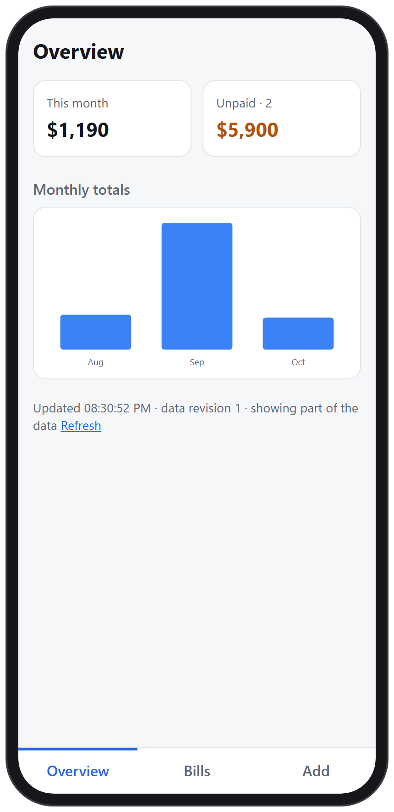
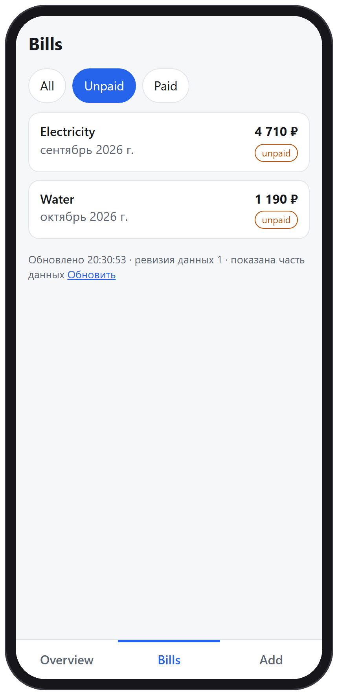
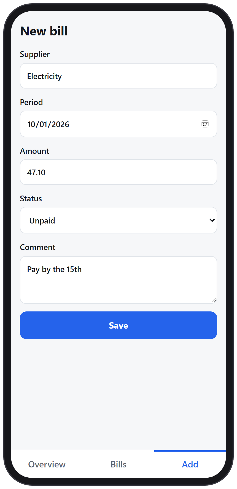
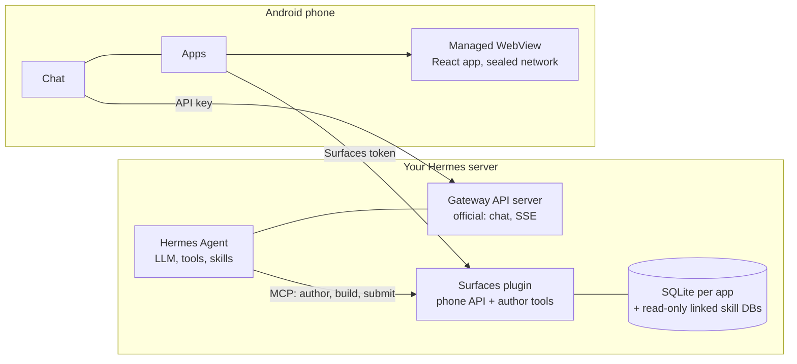

# Hermes Mobile Surfaces

[English](README.md) · [Русский](README.ru.md) · [简体中文](README.zh-CN.md) · [Português (Brasil)](README.pt-BR.md) · [한국어](README.ko.md) · **日本語** · [Español](README.es.md)

[Hermes Agent](https://hermes-agent.nousresearch.com/) 用の Android アプリです。自分の Hermes とチャットできるほか、
**Hermes が作ってくれるミニアプリ**を使えます。

チャットで Hermes に画面を頼みます（「光熱費の請求書の画面」など）。Hermes が小さな React アプリを書き、サーバー側のプラグインが
ビルドし、スマートフォンがそれを独立したアプリとして表示します。すぐに開き、保存したコピーでオフラインでも動き、実際のデータを読み、
直したいときは Hermes にもう一度頼むだけです。アプリを開いたりフィルターを切り替えたりしても LLM へのリクエストは発生せず、
モデルが使われるのはアプリを作るときと変更するときだけです。スマートフォンでプレビューを確認し、スマートフォン上で作った署名で
承認するまで、何も公開されません。

| 概要 | 請求書 | 新しい請求書 |
|:---:|:---:|:---:|
|  |  |  |

*サンプルのミニアプリ（`react-app` テンプレート、架空のデータ）。Hermes はチャットでの依頼からこのような画面を作ります。*

- **チャット**: Hermes の公式 Gateway API で Hermes と会話します。ストリーミング応答、セッション、音声、添付ファイル、回答が
  できたときの通知に対応します。
- **アプリ（Apps）**: ミニアプリの一覧、承認または却下するプレビュー、アプリの削除（サーバーのごみ箱に 30 日間保管）、自動で
  最新に保たれるオフラインコピー。
- **タスク（Tasks）**: Hermes の cron ジョブ。作成、一時停止、実行ができ、結果の送り先（Telegram、タスクを作ったチャット、
  どこにも送らない）を選べます。
- **ロックインなし**: サーバー側は Hermes の隣で動く小さな Python サービスです。Hermes 本体は変更しません。

状況: 作者のスマートフォンとサーバーで最初から最後まで動作します（Hermes 0.21.x で確認）。プレリリースで、独立したセキュリティ
レビューは受けていません。何かをインターネットに公開する前に、[セキュリティ](#セキュリティ)を読んでください。

アプリの Apps 画面は現在、英語とロシア語でのみ表示されます。この文書ではボタン名を表示どおり英語で記します。

## 全体像



- **作成。** Hermes はプラグインのツールでアプリのソースを編集します。プラグインは時間とメモリの制限がある固定テンプレートで
  ソースを検査・ビルドし、不変のバンドルを作ります。スマートフォンが承認デバイスとしてペアリングされている場合、公開は提出に
  すぎません。スマートフォンがそのビルドを実データのプレビューとして表示し、あなたがスマートフォン上で作った署名で公開または
  却下します。
- **利用。** スマートフォンはダイジェストを指定してバンドルをダウンロードし、検証し、アトミックにインストールして、ローカルの
  origin から実行します。ページは自分でネットワークリクエストを送れません。名前付きクエリをアプリに頼み、アプリがサーバー、または
  最後に保存したコピーから答えます。

## インストール

Hermes が動いている場所に、systemd 247+、`venv` 付きの Python 3.11+、`git` を備えた Linux サーバーが必要です。Hermes に
インターフェース画面をビルドさせるなら Node.js 20+ も必要です（`--with-authoring`）。アプリのビルドには Flutter 3.44（stable）、
JDK 17、Android SDK 36 が必要です。手順は必ずこの順に行ってください。Hermes に書き込み権限を渡す前（手順 6）に、スマートフォンの
ペアリングを済ませておく必要があります。

**Hermes に任せることもできます。** インストール用スキルを Hermes に一度だけ入れ、このサーバー上のチャットで、このリポジトリのアドレスから Hermes Mobile Surfaces をインストールするよう頼んでください。スキルは以下の手順と同じインストーラーを実行し、まず計画を見せ、変更のたびに確認し、Hermes を通す前にスマートフォンをペアリングします。アプリをスマートフォンに入れることはできません（手順 3）。

```sh
hermes skills install famfamfam/hermes-miniapps/skills/surfaces-install
```

チャットでは `/skills install …` でも同じです。スキルは [skills/surfaces-install](skills/surfaces-install/SKILL.md) にあります。短いので先に読んでください。

### 1. サーバー

```sh
git clone <this repository> hermes-miniapps && cd hermes-miniapps
python3 tools/install/install.py plan
sudo python3 tools/install/install.py apply --with-authoring --enable --start
```

`plan` はすべての変更を表示し、何も書き込みません。`apply` は `/opt/hermes-surfaces`（コード、仮想環境、Hermes のスキル）、
`/etc/hermes-surfaces/` にランダムなトークン 2 つ（モード 0600）、強化された systemd サービスを作り、インストールを記録します。
`--write-hermes-config` を付けない限り Hermes 自身のファイルは編集せず、ポートが使用中だったり前提条件が欠けていたりすると、
何も変更せずに拒否します。`/usr/bin/python3` のようなシステムの Python が必要です。Debian や Ubuntu では先に
`apt install python3-venv` を実行してください。

| オプション | 効果 |
|---|---|
| `--with-authoring` | Hermes がインターフェース画面をビルドできるようにします。Node.js 20+ が必要で、node が `/root` や `/home` 配下にある場合は `--copy-node` で専用のコピーを使います。 |
| `--limits small` | 小さなホスト向けのメモリと CPU の上限です。authoring を使うなら、空きメモリを約 450 MiB 見込んでください。 |
| `--scope user` | root なし: ファイルは `~/.local` 配下、`systemctl --user` を使います。自分の権限で動くため、サーバーではシステムスコープを推奨します。 |
| `--write-hermes-config` | 手順 6 の Hermes の設定項目をインストーラーに追加させます（バックアップ付き）。 |
| `--wheelhouse DIR` | あらかじめビルドした wheel からのオフラインインストール。 |
| `--host ADDR` | スマートフォン用 API を別のアドレスにバインドします。平文の HTTP なので、先に[セキュリティ](#セキュリティ)を読んでください。 |

確認:

```sh
sudo /opt/hermes-surfaces/venv/bin/python -m mobile_surfaces.install status --health --scope system
```

### 2. Hermes の API サーバー（チャット用）

チャットは Hermes の公式 API サーバーと通信しますが、これは既定でオフです。Hermes プロファイルの `~/.hermes/.env` に次を書きます。

```text
API_SERVER_ENABLED=true
API_SERVER_KEY=<your own long random key>
API_SERVER_HOST=127.0.0.1
API_SERVER_PORT=8642
```

Hermes のゲートウェイを再起動してください。キーは loopback でも必須で、Surfaces のトークンとは別のものにします。この API は
**ターミナルを含むエージェントのすべてのツール**に届きます。loopback のままにして、トンネル、VPN、または専用キー付きの HTTPS
アドレス経由で接続してください。詳細: [Hermes API server](https://hermes-agent.nousresearch.com/docs/user-guide/features/api-server)。

### 3. アプリ

いちばん簡単なのは、[Releases](https://github.com/famfamfam/hermes-miniapps/releases) ページの署名済み APK を使う方法です。スマートフォンで開くか（ブラウザやファイル管理アプリからのインストールを許可してください）、`adb install -r` でインストールします。リリースはすべてプロジェクトの同じ鍵で署名されているため、次のリリースは前のものに上書きインストールできます。自分でビルドする場合:

```sh
cd client
flutter pub get
flutter build apk --release
adb install -r build/app/outputs/flutter-apk/app-release.apk
```

`client/key.properties` がなければ、リリース APK はこのマシンのデバッグキーで署名されるので、そのままインストールできます。
自分のキーで署名するには、`storeFile`、`storePassword`、`keyAlias`、`keyPassword` を書いた `client/key.properties` を作ります。
更新には、同じアプリケーション ID（`dev.hermes.hermes_surfaces_example`）、同じキー、より大きいビルド番号（`--build-number`）が必要です。

### 4. スマートフォンからサーバーに届くようにする

Surfaces や Hermes のポートをそのままインターネットに公開しないでください。次のいずれかを選びます。

| 方法 | やり方 |
|---|---|
| USB（試用） | スマートフォン向けの 2 つのポートを転送します。作者用のポート 8788 は絶対に転送しないでください。アプリは `http://127.0.0.1:18642`（チャット）と `http://127.0.0.1:18787`（Apps）を使います。 |
| VPN | WireGuard、Tailscale など。`--host <VPN のアドレス>` でインストールします。 |
| サーバーの IP での HTTPS | トンネル、VPN、ドメインは不要: Let's Encrypt の IP 証明書、秘密のパス、レート制限を備えた nginx。手順: [tools/edge](tools/edge/README.md)。 |

```sh
ssh -N -L 127.0.0.1:18642:127.0.0.1:8642 <user>@<server>
ssh -N -L 127.0.0.1:18787:127.0.0.1:8787 <user>@<server>
adb reverse tcp:18642 tcp:18642
adb reverse tcp:18787 tcp:18787
```

アプリで自分の Hermes を追加します。手順 2 の Gateway のアドレスと API キーを入力してください。短いメッセージを 1 通送って、
チャットが動くことを確認します。

### 5. スマートフォンのペアリング

Apps 画面は**接続文字列**（`HAP1.…`）で接続します。スマートフォン用 API のアドレスと、15 分間有効で 1 回だけ使えるワンタイム
コードが入っており、トークンではありません。スマートフォンはこれをトークンと交換し、アプリの公開と削除を確認するデバイスとして
自分を登録します。最初にペアリングしたスマートフォンが承認デバイスになり、どれもペアリングされていない間はエージェントの
`app_publish` がレビューなしで公開してしまうので、手順 6 の**前に**行ってください。

スマートフォンが使うアドレスを書き込み、コードを要求します。

```sh
sudo sh -c 'umask 077; echo "<address the phone uses>" > /etc/hermes-surfaces/public-url'
sudo /opt/hermes-surfaces/venv/bin/python -I -m ms_admin pair-code --token-file /etc/hermes-surfaces/api-token
```

アドレスは、上の USB トンネルなら `http://127.0.0.1:18787`、HTTPS の手順なら `https://<host>:<port>/<secret>/ms` です（末尾に
`/api/...` は付けません）。表示された `HAP1.` の行をスマートフォンにコピーし、**Apps → Paste connection code** を開いて
"Connect to *host*?" を確認します。クリップボードは、ボタンを押したときだけ読み取られます。スマートフォンがペアリングされたか
確認するには、スマートフォン用 API の health の応答に `"approverPaired": true` があることを確かめます。

```sh
curl -s -H "Authorization: Bearer $(sudo cat /etc/hermes-surfaces/api-token)" http://127.0.0.1:8787/api/plugins/mobile-surfaces/v1/health
```

Hermes を接続したあと（手順 6）は、"connect the phone app" と話しかけるだけで Hermes が自分で行を送ってくれます
（`surfaces-connect-phone` スキルを使います）。

コードで、すでにペアリング済みの承認デバイスを置き換えることはできません。置き換え（スマートフォンの紛失）は管理者の操作で、
`ms_admin approvers --clear` を実行してから新しいコードを発行します。

### 6. Hermes を Surfaces に接続する

`~/.hermes/config.yaml` に次を追加します。

```yaml
mcp_servers:
  surfaces:
    url: "http://127.0.0.1:8788/mcp"
    trust: untrusted
    timeout: 180
    headers:
      Authorization: "Bearer ${MOBILE_SURFACES_MCP_TOKEN}"
skills:
  external_dirs:
    - /opt/hermes-surfaces/skills
```

トークンを表示せずに `~/.hermes/.env` へ書き込み、Hermes のチャットで `/reload-mcp` を実行して、新しいセッションを始めます。

```sh
umask 077 && printf 'MOBILE_SURFACES_MCP_TOKEN=%s\n' "$(sudo cat /etc/hermes-surfaces/mcp-token)" >> ~/.hermes/.env
```

お使いの Hermes がヘッダーの `${...}` を展開しない場合（401 になります）は、`--hermes-token-mode inline` でインストールしてください。
手で編集する代わりに、`apply` に `--write-hermes-config` を渡すこともできます。各ファイルを先にバックアップし、自分の項目に印を付け、
自分が作っていない項目は決して上書きしません。

`trust: untrusted` では、プラグインが行うすべての書き込み（ファイルの作成、ビルド、公開）について Hermes が確認を求めます。
1 つのアプリで質問が多くなります。`trust: full` ならその質問がなくなり、スマートフォンがペアリングされていれば、アプリの公開と
削除には引き続きそのスマートフォンの署名が必要です。どちらを選んでも、Hermes の `approvals.timeout` は既定の 300 秒のままにして
ください。それより遅い回答は HTTP 409 になり、アプリは確認の期限が切れたと表示します。

### 7. アプリを作る

チャットで Hermes に頼みます。「毎月の支出の画面を作って」。ビルドが終わると、**Apps → Waiting for your decision** にプレビューが
現れます。実データで開いてから、公開または却下してください。変更も同じように頼みます。アプリを削除するには ⋮ → Delete app を使います。
アプリはサーバーのごみ箱に 30 日間移されます（`ms_admin trash`、`ms_admin restore-app <name>`）。

## アップグレードとアンインストール

```sh
git pull && python3 tools/install/install.py plan --upgrade
sudo python3 tools/install/install.py apply --upgrade
sudo python3 tools/install/install.py uninstall
sudo python3 tools/install/install.py uninstall --purge --yes
```

`--upgrade` はトークンとデータを残します。`uninstall` はユニットとコードを削除し、データとトークンは残します。`--purge` はデータベースと
トークンも削除します。Hermes は `--write-hermes-config` を付けたときだけ変更されます。付けなかった場合は、`mcp_servers.surfaces`
ブロックと `MOBILE_SURFACES_MCP_TOKEN` の行を自分で削除してください。

## トラブルシューティング

| 症状 | 原因と対処 |
|---|---|
| Apps に "Surfaces is not set up" と表示される | **Paste connection code** を押します（先に Hermes に行を頼むか、`pair-code` を実行）。チャットには影響しません。 |
| "The server rejected the token" | トークンが違うか、更新されました。新しい接続文字列を入手してください。Gateway のキーではありません。 |
| "The code is wrong or has expired" | 接続文字列は 1 回限りで、15 分間有効です。5 回間違えると、サーバーは 1 分間待ちます。 |
| 古い時刻つきの "Offline" | サーバーへの経路がありません（トンネル切断、`adb reverse` の消失）。保存済みのアプリは開け、アプリが自動で再試行します。 |
| 確認の期限切れ（the confirmation expired） | Hermes が待つのをやめました（`approvals.timeout`）。同じ操作をもう一度頼んでください。 |
| 承認、却下、削除が無効 | このスマートフォンはペアリング済みの承認デバイスではありません。 |
| `already installed ... --upgrade` | 想定どおりの動作です。先に `apply --upgrade` か `uninstall` を実行してください。 |
| `ensurepip is not available` | `apt install python3-venv`。 |
| サービスがステータス 203/EXEC で終了する | サンドボックス内のサービスは `/home` や `/root` 配下の Python を実行できません: `--python /usr/bin/python3` を使います。 |
| Hermes: `hermes mcp test surfaces` で 401 | `.env` のトークンが古いか、`--hermes-token-mode inline` を使ってください。 |
| `INSTALL_FAILED_UPDATE_INCOMPATIBLE` | インストール済みのアプリと署名キーが違います。 |
| ビルドが強制終了される | メモリ不足です。swap かメモリを増やすか、`--with-authoring` を外してください（`journalctl -u hermes-surfaces`）。 |

## セキュリティ

- サービスは権限のない一時的なユーザーとして動きます。ホームなし、読み取り専用の OS、専用の `/tmp`、デバイスや権限なしで、loopback に
  バインドしている場合は、他のアドレスへの送信も他のアドレスからの受信もできません。書き込めるのは自分の状態ディレクトリだけです。
- 秘密は 3 つに分かれています。Hermes の API キー（ターミナルを含むエージェントのツールを実行）、Surfaces のスマートフォン用トークン、
  作者用 MCP トークン（アプリのデータを書き込み、公開）。トークンは `/etc/hermes-surfaces/`（モード 0600）にだけ存在し、ユニット、
  環境変数、コマンドライン、ログ、インストーラーの出力には決して現れません。トークンを APK、リポジトリ、チャットに入れないでください。
- 3 つのポートは loopback に置いてください。HTTPS の手順で公開するのは Gateway API とスマートフォン用 API だけで、作者用 MCP は
  決して公開しません。
- アプリのページはネットワークを封じた WebView で動きます。自分でリクエストを送ることはできず、名前付きクエリをアプリに頼めるだけです。
  作者が読むデータは、お使いのモデルプロバイダーに送られます。
- 最初にペアリングしたスマートフォンが承認デバイスになります（初回使用時に信頼）。接続コードは 1 回限りで、15 分間有効、ダイジェスト
  としてのみ保存されます。アプリの削除は別のメッセージに対する署名なので、公開の署名では何も削除できず、その逆も同じです。

既知の未解決事項と脆弱性の報告方法は [SECURITY.md](SECURITY.md) にあります。

## リポジトリ

| パス | 内容 |
|---|---|
| `client/` | Android アプリ（Flutter）: チャット、タスク、設定、Apps 画面 |
| `plugin/` | Python サーバー: SQL サンドボックス、レジストリ、バンドル、ビルダー、承認、インストーラー、Hermes のスキル |
| `packages/hermes_surfaces/` | Flutter コア: バンドルの検証、ネットワークを封じた WebView ホスト、JS ブリッジ、スナップショット |
| `packages/hermes_surfaces_bridge/` | Apps 画面と Surfaces の設定。任意の Flutter チャットアプリで使えます（[README](packages/hermes_surfaces_bridge/README.md)） |
| `packages/mobile-sdk/`、`templates/` | React SDK と、Hermes がアプリを作るときの出発点になるテンプレート |
| `tools/` | インストーラー、HTTPS の手順、補助ツール |
| `third_party/` | クライアントが必要とする 1 行の Gradle 修正を入れた WebView プラグイン |
| `contracts/` | 共通のテストデータ |

テスト: `cd plugin && python -m pytest`、および `client/`、`packages/hermes_surfaces/`、`packages/hermes_surfaces_bridge/` での
`flutter test`。[CONTRIBUTING.md](CONTRIBUTING.md) を参照してください。

## ライセンス

[MIT](LICENSE)。`client/` のアプリは [rusty4444/hermes-android](https://github.com/rusty4444/hermes-android)
（コミット `8f0edca2ea98`）から始まりました。
