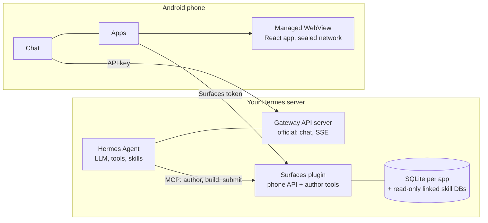

# Hermes Mobile Surfaces

[English](README.md) · [Русский](README.ru.md) · [简体中文](README.zh-CN.md) · [Português (Brasil)](README.pt-BR.md) · **한국어** · [日本語](README.ja.md) · [Español](README.es.md)

[Hermes Agent](https://hermes-agent.nousresearch.com/)용 Android 앱입니다. 내 Hermes와 채팅하고, **Hermes가 대신 만들어 주는
미니 앱**을 사용할 수 있습니다.

채팅에서 Hermes에게 화면을 만들어 달라고 말합니다("공과금 내역 화면"처럼요). Hermes가 작은 React 앱을 작성하고, 서버
플러그인이 이를 빌드하면, 휴대폰이 그것을 하나의 독립된 앱처럼 보여 줍니다. 즉시 열리고, 저장된 사본으로 오프라인에서도
동작하며, 내 실제 데이터를 읽습니다. 고치고 싶을 때는 Hermes에게 다시 말하면 됩니다. 앱을 열거나 필터를 바꾸는 데는 LLM
요청이 들지 않으며, 모델은 앱을 만들거나 바꿀 때만 사용됩니다. 휴대폰에서 미리보기를 확인하고 휴대폰에서 만든 서명으로
승인하기 전에는 아무것도 공개되지 않습니다.

- **채팅**: Hermes의 공식 Gateway API로 대화합니다. 스트리밍 응답, 세션, 음성, 첨부 파일, 답변이 준비되면 알림.
- **앱(Apps)**: 내 미니 앱 목록, 승인하거나 거절할 미리보기, 앱 삭제(서버 휴지통에 30일 보관), 스스로 최신 상태를 유지하는
  오프라인 사본.
- **작업(Tasks)**: Hermes의 cron 작업. 만들기, 일시 중지, 실행, 그리고 결과를 보낼 곳 선택(Telegram, 작업을 만든 채팅,
  또는 어디에도 보내지 않음).
- **종속 없음**: 서버 쪽은 Hermes 옆에서 도는 작은 Python 서비스입니다. Hermes 자체는 전혀 수정하지 않습니다.

상태: 작성자의 휴대폰과 서버에서 처음부터 끝까지 동작합니다(Hermes 0.21.x에서 테스트). 사전 릴리스이며 독립적인 보안 검토를
받지 않았습니다. 무엇이든 인터넷에 노출하기 전에 [보안](#보안) 절을 먼저 읽으세요.

앱의 Apps 화면은 현재 영어와 러시아어로만 표시됩니다. 이 문서는 그 버튼 이름을 영어 그대로 적습니다.

## 전체 구조



- **제작.** Hermes는 플러그인의 도구로 앱의 소스를 편집합니다. 플러그인은 시간과 메모리 제한이 있는 고정 템플릿에서 소스를
  검사하고 빌드하여 변경 불가능한 번들을 만듭니다. 휴대폰이 승인 기기로 페어링되어 있으면 게시는 제출일 뿐입니다. 휴대폰이 그
  빌드를 실제 데이터로 미리보기로 보여 주고, 사용자가 휴대폰에서 만든 서명으로 게시하거나 거절합니다.
- **사용.** 휴대폰은 다이제스트로 번들을 내려받아 검증하고, 원자적으로 설치하여 로컬 origin에서 실행합니다. 페이지는 스스로
  네트워크 요청을 보낼 수 없습니다. 이름이 붙은 쿼리를 앱에 요청하면, 앱이 서버 또는 마지막으로 저장한 사본에서 답합니다.

## 설치

Hermes가 실행되는 곳에 systemd 247+, `venv`가 포함된 Python 3.11+, `git`이 있는 Linux 서버가 필요합니다. Hermes가 인터페이스
화면을 빌드하게 하려면 Node.js 20+도 필요합니다(`--with-authoring`). 앱을 빌드하려면 Flutter 3.44(stable), JDK 17, Android SDK 36이
필요합니다. 반드시 이 순서대로 진행하세요. Hermes에 쓰기 권한을 주기 전에(6단계) 휴대폰이 먼저 페어링되어 있어야 합니다.

**또는 Hermes에게 맡기세요.** 설치 스킬을 Hermes에 한 번 설치한 뒤, 이 서버의 채팅에서 이 저장소 주소로 Hermes Mobile Surfaces를 설치해 달라고 요청하면 됩니다. 이 스킬은 아래 단계와 같은 설치 프로그램을 실행하고, 계획을 먼저 보여 주며, 변경할 때마다 먼저 묻고, Hermes에 접근 권한을 주기 전에 휴대폰을 페어링합니다. 앱을 휴대폰에 설치하는 것은 할 수 없습니다(3단계).

```sh
hermes skills install famfamfam/hermes-miniapps/skills/surfaces-install
```

채팅에서는 `/skills install …` 로도 같은 일을 할 수 있습니다. 스킬은 [skills/surfaces-install](skills/surfaces-install/SKILL.md)에 있으며 짧으니 먼저 읽어 보세요.

### 1. 서버

```sh
git clone <this repository> hermes-miniapps && cd hermes-miniapps
python3 tools/install/install.py plan
sudo python3 tools/install/install.py apply --with-authoring --enable --start
```

`plan`은 모든 변경 사항을 보여 주고 아무것도 쓰지 않습니다. `apply`는 `/opt/hermes-surfaces`(코드, 가상 환경, Hermes
스킬)와 `/etc/hermes-surfaces/`의 무작위 토큰 두 개(권한 0600), 강화된 systemd 서비스를 만들고 설치 기록을 남깁니다.
`--write-hermes-config`를 주지 않는 한 Hermes 자체의 파일은 수정하지 않으며, 포트가 사용 중이거나 필수 요소가 없으면 아무것도
바꾸지 않고 거부합니다. `/usr/bin/python3` 같은 시스템 Python이 필요합니다. Debian이나 Ubuntu에서는 먼저
`apt install python3-venv`를 실행하세요.

| 옵션 | 효과 |
|---|---|
| `--with-authoring` | Hermes가 인터페이스 화면을 빌드할 수 있게 합니다. Node.js 20+가 필요하며, node가 `/root`나 `/home` 아래에 있으면 `--copy-node`로 전용 사본을 사용합니다. |
| `--limits small` | 작은 호스트를 위한 메모리·CPU 상한입니다. authoring을 켜면 여유 메모리를 약 450 MiB 잡아 두세요. |
| `--scope user` | root 없이: `~/.local` 아래에 파일을 두고 `systemctl --user`를 씁니다. 내 권한으로 실행되므로 서버에서는 시스템 범위를 권장합니다. |
| `--write-hermes-config` | 6단계의 Hermes 항목을 설치 프로그램이 추가하게 합니다(백업 포함). |
| `--wheelhouse DIR` | 미리 빌드한 wheel로 오프라인 설치합니다. |
| `--host ADDR` | 휴대폰 API를 다른 주소에 바인딩합니다. 평문 HTTP이므로 먼저 [보안](#보안)을 읽으세요. |

확인:

```sh
sudo /opt/hermes-surfaces/venv/bin/python -m mobile_surfaces.install status --health --scope system
```

### 2. Hermes API 서버(채팅용)

채팅은 Hermes의 공식 API 서버와 통신하며, 이 서버는 기본적으로 꺼져 있습니다. Hermes 프로필의 `~/.hermes/.env`에 다음을 넣으세요.

```text
API_SERVER_ENABLED=true
API_SERVER_KEY=<your own long random key>
API_SERVER_HOST=127.0.0.1
API_SERVER_PORT=8642
```

Hermes 게이트웨이를 재시작하세요. 키는 loopback에서도 필수이며 Surfaces 토큰과 달라야 합니다. 이 API는 **터미널을 포함한 에이전트의
모든 도구**에 닿습니다. loopback에만 두고, 터널, VPN, 또는 자체 키가 있는 HTTPS 주소로 접속하세요. 자세한 내용:
[Hermes API server](https://hermes-agent.nousresearch.com/docs/user-guide/features/api-server).

### 3. 앱

가장 빠른 방법은 [Releases](https://github.com/famfamfam/hermes-miniapps/releases) 페이지에서 서명된 APK를 받는 것입니다. 휴대폰에서 열거나(브라우저나 파일 관리자에서 앱 설치를 허용해야 합니다) `adb install -r` 로 설치하세요. 모든 릴리스는 프로젝트의 같은 키로 서명되므로 다음 버전을 이전 버전 위에 그대로 설치할 수 있습니다. 직접 빌드하려면:

```sh
cd client
flutter pub get
flutter build apk --release
adb install -r build/app/outputs/flutter-apk/app-release.apk
```

`client/key.properties`가 없으면 릴리스 APK는 이 컴퓨터의 디버그 키로 서명되므로 그대로 설치됩니다. 자신의 키로 서명하려면
`storeFile`, `storePassword`, `keyAlias`, `keyPassword`를 담은 `client/key.properties`를 만드세요. 업데이트하려면 같은 애플리케이션 ID
(`dev.hermes.hermes_surfaces_example`), 같은 키, 더 높은 빌드 번호(`--build-number`)가 필요합니다.

### 4. 휴대폰에서 서버에 접속하기

Surfaces나 Hermes 포트를 그대로 인터넷에 열지 마세요. 접속 방법을 하나 고르세요.

| 방법 | 어떻게 |
|---|---|
| USB(시험용) | 휴대폰 쪽 포트 두 개를 포워딩합니다. 작성자 포트 8788은 절대 포워딩하지 마세요. 그러면 앱은 `http://127.0.0.1:18642`(채팅)과 `http://127.0.0.1:18787`(Apps)을 씁니다. |
| VPN | WireGuard, Tailscale 등. `--host <VPN 주소>`로 설치하세요. |
| 서버 IP의 HTTPS | 터널, VPN, 도메인 없이: Let's Encrypt IP 인증서, 비밀 경로, 요청 제한을 갖춘 nginx. 방법: [tools/edge](tools/edge/README.md). |

```sh
ssh -N -L 127.0.0.1:18642:127.0.0.1:8642 <user>@<server>
ssh -N -L 127.0.0.1:18787:127.0.0.1:8787 <user>@<server>
adb reverse tcp:18642 tcp:18642
adb reverse tcp:18787 tcp:18787
```

앱에서 내 Hermes를 추가하세요. 2단계의 Gateway 주소와 API 키를 입력합니다. 짧은 메시지를 하나 보내 채팅이 되는지 확인하세요.

### 5. 휴대폰 페어링

Apps 화면은 **연결 문자열**(`HAP1.…`)로 연결합니다. 휴대폰 API의 주소와 일회용 코드가 들어 있으며, 15분 동안 유효하고 한 번만 쓸
수 있습니다. 토큰이 아닙니다. 휴대폰은 이를 토큰으로 교환하고, 앱의 게시와 삭제를 확인하는 기기로 자신을 등록합니다. 처음
페어링한 휴대폰이 승인 기기가 되며, 페어링된 기기가 없는 동안에는 에이전트의 `app_publish`가 검토 없이 게시되므로 이 단계는 6단계
**이전에** 하세요.

휴대폰이 서버에 접속할 때 쓰는 주소를 기록한 다음 코드를 요청하세요.

```sh
sudo sh -c 'umask 077; echo "<address the phone uses>" > /etc/hermes-surfaces/public-url'
sudo /opt/hermes-surfaces/venv/bin/python -I -m ms_admin pair-code --token-file /etc/hermes-surfaces/api-token
```

주소는 위의 USB 터널을 쓰면 `http://127.0.0.1:18787`, HTTPS 방식이면 `https://<host>:<port>/<secret>/ms`입니다(끝에 `/api/...`는
붙이지 않습니다). 출력된 `HAP1.` 줄을 휴대폰에 복사하고 **Apps → Paste connection code**를 열어 "Connect to *host*?"를 확인하세요.
클립보드는 버튼을 누를 때만 읽습니다. 휴대폰이 페어링되었는지 확인하려면, 휴대폰 API의 health 응답에 `"approverPaired": true`가
있어야 합니다.

```sh
curl -s -H "Authorization: Bearer $(sudo cat /etc/hermes-surfaces/api-token)" http://127.0.0.1:8787/api/plugins/mobile-surfaces/v1/health
```

Hermes가 연결된 뒤(6단계)에는 "connect the phone app"이라고 말하기만 해도 Hermes가 직접 그 줄을 보내 줍니다
(`surfaces-connect-phone` 스킬을 사용합니다).

코드로는 이미 페어링된 승인 기기를 바꿀 수 없습니다. 교체(휴대폰 분실)는 관리자 작업이며 `ms_admin approvers --clear`를 실행한 뒤
새 코드를 받으세요.

### 6. Hermes를 Surfaces에 연결

`~/.hermes/config.yaml`에 추가하세요.

```yaml
mcp_servers:
  surfaces:
    url: "http://127.0.0.1:8788/mcp"
    trust: untrusted
    timeout: 180
    headers:
      Authorization: "Bearer ${MOBILE_SURFACES_MCP_TOKEN}"
skills:
  external_dirs:
    - /opt/hermes-surfaces/skills
```

토큰을 출력하지 않고 `~/.hermes/.env`에 넣은 다음, Hermes 채팅에서 `/reload-mcp`를 실행하고 새 세션을 시작하세요.

```sh
umask 077 && printf 'MOBILE_SURFACES_MCP_TOKEN=%s\n' "$(sudo cat /etc/hermes-surfaces/mcp-token)" >> ~/.hermes/.env
```

Hermes가 헤더의 `${...}`를 확장하지 않으면(401이 나옵니다) `--hermes-token-mode inline`으로 설치하세요. 직접 편집하는 대신 `apply`에
`--write-hermes-config`를 줄 수도 있습니다. 각 파일을 먼저 백업하고, 자신의 항목에 표시를 남기며, 자신이 만들지 않은 항목은 절대
덮어쓰지 않습니다.

`trust: untrusted`는 플러그인이 하는 모든 쓰기(파일 생성, 빌드, 게시)마다 Hermes가 확인을 요청하게 합니다. 앱 하나에 질문이 많아집니다.
`trust: full`은 그 질문을 없애며, 휴대폰이 페어링되어 있다면 앱의 게시와 삭제에는 여전히 그 휴대폰의 서명이 필요합니다. 어느 쪽을
고르든 Hermes의 `approvals.timeout`은 기본값인 300초로 두세요. 더 늦게 오는 응답은 HTTP 409를 받고, 앱은 확인이 만료되었다고
알려 줍니다.

### 7. 앱 만들기

채팅에서 Hermes에게 말하세요. "매달 지출을 보여 주는 화면을 만들어 줘". 빌드가 끝나면 **Apps → Waiting for your decision**에 미리보기가 나타납니다.
실제 데이터로 열어 본 다음 게시하거나 거절하세요. 변경도 같은 방식으로 요청하면 됩니다. 앱을 삭제하려면 ⋮ → Delete app을 쓰세요. 앱은
서버 휴지통으로 가서 30일간 보관됩니다(`ms_admin trash`, `ms_admin restore-app <name>`).

## 업그레이드와 제거

```sh
git pull && python3 tools/install/install.py plan --upgrade
sudo python3 tools/install/install.py apply --upgrade
sudo python3 tools/install/install.py uninstall
sudo python3 tools/install/install.py uninstall --purge --yes
```

`--upgrade`는 토큰과 데이터를 유지합니다. `uninstall`은 유닛과 코드를 지우고 데이터와 토큰은 남기며, `--purge`는 데이터베이스와 토큰도 지웁니다.
Hermes는 `--write-hermes-config`를 줄 때만 바뀝니다. 그렇지 않으면 `mcp_servers.surfaces` 블록과 `MOBILE_SURFACES_MCP_TOKEN` 줄을 직접 지우세요.

## 문제 해결

| 증상 | 원인과 해결 |
|---|---|
| Apps에 "Surfaces is not set up"이 표시됨 | **Paste connection code**를 누르세요(먼저 Hermes에게 줄을 요청하거나 `pair-code`를 실행). 채팅에는 영향이 없습니다. |
| "The server rejected the token" | 토큰이 틀렸거나 교체되었습니다. 새 연결 문자열을 받으세요. Gateway 키가 아닙니다. |
| "The code is wrong or has expired" | 연결 문자열은 한 번, 15분 동안만 유효합니다. 다섯 번 틀리면 서버가 1분간 기다립니다. |
| 오래된 시각과 함께 "Offline" | 서버로 가는 경로가 없습니다(터널 끊김, `adb reverse` 소실). 저장된 앱은 계속 열리고 앱이 스스로 다시 시도합니다. |
| 확인이 만료됨(the confirmation expired) | Hermes가 기다리기를 멈췄습니다(`approvals.timeout`). 같은 작업을 다시 요청하세요. |
| 승인, 거절, 삭제가 비활성 | 이 휴대폰은 페어링된 승인 기기가 아닙니다. |
| `already installed ... --upgrade` | 의도된 동작입니다. 먼저 `apply --upgrade` 또는 `uninstall`을 실행하세요. |
| `ensurepip is not available` | `apt install python3-venv`. |
| 서비스가 203/EXEC 상태로 종료됨 | 샌드박스 안의 서비스는 `/home`이나 `/root` 아래의 Python을 실행할 수 없습니다. `--python /usr/bin/python3`을 쓰세요. |
| Hermes: `hermes mcp test surfaces`에서 401 | `.env`의 토큰이 오래되었거나, `--hermes-token-mode inline`을 쓰세요. |
| `INSTALL_FAILED_UPDATE_INCOMPATIBLE` | 설치된 앱과 서명 키가 다릅니다. |
| 빌드가 강제 종료됨 | 메모리 문제입니다. swap이나 메모리를 늘리거나 `--with-authoring`을 끄세요(`journalctl -u hermes-surfaces`). |

## 보안

- 서비스는 권한이 없는 임시 사용자로 실행됩니다. 홈 디렉터리 없음, 읽기 전용 OS, 비공개 `/tmp`, 장치와 권한 없음이며, loopback에
  바인딩하면 다른 주소로 트래픽을 보내지도 받지도 못합니다. 자신의 상태 디렉터리에만 쓸 수 있습니다.
- 서로 분리된 비밀이 세 가지 있습니다. Hermes API 키(터미널을 포함해 에이전트의 도구를 실행), Surfaces 휴대폰 토큰, 작성자 MCP
  토큰(앱 데이터를 쓰고 게시). 토큰은 `/etc/hermes-surfaces/`(권한 0600)에만 있으며, 유닛, 환경 변수, 명령줄, 로그, 설치 프로그램
  출력에는 절대 나타나지 않습니다. 토큰을 APK, 저장소, 채팅에 넣지 마세요.
- 세 포트는 loopback에 두세요. HTTPS 방식은 Gateway API와 휴대폰 API만 노출하며, 작성자 MCP는 절대 노출하지 않습니다.
- 앱 페이지는 네트워크가 봉인된 WebView에서 실행됩니다. 스스로 요청을 보낼 수 없고, 이름이 붙은 쿼리를 앱에 요청할 수만 있습니다.
  작성자가 읽는 데이터는 사용 중인 모델 제공자에게 전송됩니다.
- 처음 페어링한 휴대폰이 승인 기기가 됩니다(처음 사용 시 신뢰). 연결 코드는 일회용이며 15분간 유효하고 다이제스트로만 저장됩니다. 앱
  삭제는 별도의 메시지에 대해 서명하므로 게시 서명으로는 아무것도 삭제할 수 없고, 그 반대도 마찬가지입니다.

알려진 미해결 사항과 취약점 신고 방법은 [SECURITY.md](SECURITY.md)에 있습니다.

## 저장소

| 경로 | 내용 |
|---|---|
| `client/` | Android 앱(Flutter): 채팅, 작업, 설정, Apps 화면 |
| `plugin/` | Python 서버: SQL 샌드박스, 레지스트리, 번들, 빌더, 승인, 설치 프로그램, Hermes 스킬 |
| `packages/hermes_surfaces/` | Flutter 코어: 번들 검증, 네트워크가 봉인된 WebView 호스트, JS 브리지, 스냅샷 |
| `packages/hermes_surfaces_bridge/` | Apps 화면과 Surfaces 설정. 어떤 Flutter 채팅 앱에서도 쓸 수 있습니다([README](packages/hermes_surfaces_bridge/README.md)) |
| `packages/mobile-sdk/`, `templates/` | React SDK와 Hermes가 앱을 만들 때 쓰는 시작 템플릿 |
| `tools/` | 설치 프로그램, HTTPS 방법, 보조 도구 |
| `third_party/` | 클라이언트에 필요한 한 줄짜리 Gradle 수정이 들어간 WebView 플러그인 |
| `contracts/` | 공용 테스트 데이터 |

테스트: `cd plugin && python -m pytest`, 그리고 `client/`, `packages/hermes_surfaces/`, `packages/hermes_surfaces_bridge/`에서 `flutter test`.
[CONTRIBUTING.md](CONTRIBUTING.md)를 참고하세요.

## 라이선스

[MIT](LICENSE). `client/`의 앱은 [rusty4444/hermes-android](https://github.com/rusty4444/hermes-android)(커밋 `8f0edca2ea98`)에서
출발했습니다.
