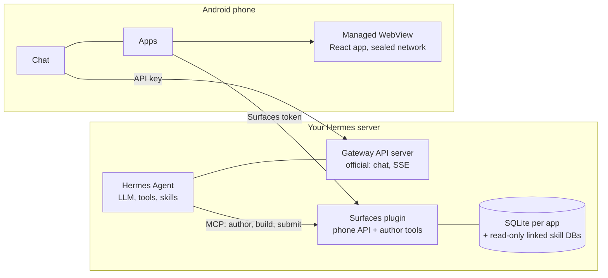

# Hermes Mobile Surfaces

**English** · [Русский](README.ru.md) · [简体中文](README.zh-CN.md) · [Português (Brasil)](README.pt-BR.md) · [한국어](README.ko.md) · [日本語](README.ja.md) · [Español](README.es.md)

An Android app for [Hermes Agent](https://hermes-agent.nousresearch.com/): chat with your Hermes plus **mini-apps that
Hermes builds for you**.

You ask Hermes in chat for a screen ("a screen for my utility bills"). Hermes writes a small React app, a server plugin
builds it, and your phone shows it as an app of its own: it opens instantly, works offline from a saved copy, reads your
real data, and you refine it by talking to Hermes again. Opening an app and switching filters cost no LLM request; the
model is used only when an app is created or changed. Nothing goes live until you have seen a preview on the phone and
approved it with a signature made on the phone.

- **Chat** with Hermes through its official Gateway API: streaming, sessions, voice, attachments, a notification when an
  answer is ready.
- **Apps**: the catalogue of your mini-apps, previews to approve or reject, deleting an app (kept 30 days in a trash on
  the server), offline copies that keep themselves up to date.
- **Tasks**: your Hermes cron jobs. Create, pause, run, and choose where the result goes: Telegram, the chat it came
  from, or nowhere.
- **No lock-in**: the server part is a small Python service next to your Hermes. Nothing of Hermes itself is modified.

Status: works end to end on the author's phone and server (tested against Hermes 0.21.x). It is pre-release and has had
no independent security review: read [Security](#security) before exposing anything to the internet.

## How it fits together



- **Authoring.** Hermes edits the sources of an app through the plugin's tools. The plugin lints and builds them in a
  fixed template with time and memory limits and produces an immutable bundle. When a phone has been paired as approver,
  publishing is only a submission: the phone shows the build as a preview on real data and you publish or reject it with
  a signature made on the phone.
- **Using.** The phone downloads the bundle by digest, verifies it, installs it atomically and runs it from a local
  origin. The page cannot make network requests of its own; it asks the app for named queries, and the app answers from
  the server or from the last saved copy.

## Install

You need a Linux server with systemd 247+, Python 3.11+ with `venv` and `git` where Hermes runs; Node.js 20+ if Hermes
should build interface screens (`--with-authoring`). To build the app: Flutter 3.44 (stable), JDK 17, Android SDK 36.
Do the steps in this order: the phone must be paired before Hermes gets write access (step 6).

**Or let Hermes do it.** Give Hermes the install skill once, then ask it in a chat on that server to install Hermes Mobile
Surfaces from this repository's address. The skill runs the same installer as the steps below, shows the plan, asks
before every change, and pairs the phone before it lets Hermes in. It cannot put the app on your phone (step 3).

```sh
hermes skills install famfamfam/hermes-miniapps/skills/surfaces-install
```

In a chat the same works as `/skills install …`. The skill is [skills/surfaces-install](skills/surfaces-install/SKILL.md);
it is short, read it first.

### 1. Server

```sh
git clone <this repository> hermes-miniapps && cd hermes-miniapps
python3 tools/install/install.py plan
sudo python3 tools/install/install.py apply --with-authoring --enable --start
```

`plan` prints every change and writes nothing. `apply` creates `/opt/hermes-surfaces` (code, virtualenv, the Hermes
skills), two random tokens in `/etc/hermes-surfaces/` (mode 0600), and a hardened systemd service, and records the
install. It never edits Hermes' own files unless you pass `--write-hermes-config`, and it refuses (changing nothing) when
a port is busy or a prerequisite is missing. A system Python such as `/usr/bin/python3` is required; on Debian or Ubuntu
`apt install python3-venv` first.

| Option | Effect |
|---|---|
| `--with-authoring` | Lets Hermes build interface screens. Needs Node.js 20+; `--copy-node` uses a private copy if node lives under `/root` or `/home`. |
| `--limits small` | Memory and CPU ceilings for a small host. With authoring plan for about 450 MiB of free memory. |
| `--scope user` | No root: files under `~/.local`, `systemctl --user`. It runs with your rights, so prefer system scope on a server. |
| `--write-hermes-config` | Let the installer add the Hermes entries of step 6 (with backups). |
| `--wheelhouse DIR` | Offline install from pre-built wheels. |
| `--host ADDR` | Bind the phone API to another address. Plain HTTP; read [Security](#security) first. |

Check it:

```sh
sudo /opt/hermes-surfaces/venv/bin/python -m mobile_surfaces.install status --health --scope system
```

### 2. Hermes API server (for the chat)

The chat talks to Hermes' official API server, which is off by default. In the Hermes profile's `~/.hermes/.env`:

```text
API_SERVER_ENABLED=true
API_SERVER_KEY=<your own long random key>
API_SERVER_HOST=127.0.0.1
API_SERVER_PORT=8642
```

Restart the Hermes gateway. The key is required even on loopback and must differ from the Surfaces tokens. This API
reaches **every tool of the agent, including the terminal**: keep it on loopback and reach it through a tunnel, a VPN or
an HTTPS address with its own key. Details: [Hermes API server](https://hermes-agent.nousresearch.com/docs/user-guide/features/api-server).

### 3. The app

The quickest way is the signed APK from the [Releases](https://github.com/famfamfam/hermes-miniapps/releases) page: open it
on the phone (allow installs from your browser or file manager) or `adb install -r` it. Every release is signed with the
project's one key, so each can be installed over the previous one. To build it yourself:

```sh
cd client
flutter pub get
flutter build apk --release
adb install -r build/app/outputs/flutter-apk/app-release.apk
```

Without a `client/key.properties` the release APK is signed with your machine's debug key, so it installs as is. To sign
with your own key create `client/key.properties` with `storeFile`, `storePassword`, `keyAlias` and `keyPassword`. An
update needs the same application id (`dev.hermes.hermes_surfaces_example`), the same key and a higher build number
(`--build-number`).

### 4. Reach the server from the phone

Never open the Surfaces or Hermes ports to the internet as they are. Pick one way in:

| Way | How |
|---|---|
| USB (to try it) | Forward the two phone-facing ports; never forward the author port 8788. The app then uses `http://127.0.0.1:18642` (chat) and `http://127.0.0.1:18787` (Apps). |
| VPN | WireGuard, Tailscale and so on; install with `--host <VPN address>`. |
| HTTPS on the server's IP | No tunnel, VPN or domain: nginx with a Let's Encrypt IP certificate, a secret path and rate limits. Recipe: [tools/edge](tools/edge/README.md). |

```sh
ssh -N -L 127.0.0.1:18642:127.0.0.1:8642 <user>@<server>
ssh -N -L 127.0.0.1:18787:127.0.0.1:8787 <user>@<server>
adb reverse tcp:18642 tcp:18642
adb reverse tcp:18787 tcp:18787
```

In the app, add your Hermes: the Gateway address and the API key from step 2. Send one short message to check the chat.

### 5. Pair the phone

The Apps screen connects with a **connection line** (`HAP1.…`): the address of the phone API plus a one-time code, valid
15 minutes and usable once. It is not the token. The phone exchanges it for the token and registers itself as the device
that confirms publishing and deleting apps. The first phone to pair becomes the approver, and until one is paired an
agent's `app_publish` publishes without review, so do this **before** step 6.

Write the address your phone uses, then ask for a code:

```sh
sudo sh -c 'umask 077; echo "<address the phone uses>" > /etc/hermes-surfaces/public-url'
sudo /opt/hermes-surfaces/venv/bin/python -I -m ms_admin pair-code --token-file /etc/hermes-surfaces/api-token
```

The address is `http://127.0.0.1:18787` through the USB tunnel above, or `https://<host>:<port>/<secret>/ms` for the HTTPS
recipe (no `/api/...` at the end). Copy the printed `HAP1.` line to the phone, open **Apps → Paste connection code** and
confirm "Connect to *host*?". The clipboard is read only when you press the button. To check that the phone is paired, the
phone API's health answer must say `"approverPaired": true`:

```sh
curl -s -H "Authorization: Bearer $(sudo cat /etc/hermes-surfaces/api-token)" http://127.0.0.1:8787/api/plugins/mobile-surfaces/v1/health
```

Once Hermes is connected (step 6) you can also just tell it "connect the phone app" and it sends the line itself (it uses
the `surfaces-connect-phone` skill).

A code cannot replace an approver that is already paired. Replacing it (a lost phone) is an administrator action,
`ms_admin approvers --clear`, followed by a new code.

### 6. Connect Hermes to Surfaces

Add to `~/.hermes/config.yaml`:

```yaml
mcp_servers:
  surfaces:
    url: "http://127.0.0.1:8788/mcp"
    trust: untrusted
    timeout: 180
    headers:
      Authorization: "Bearer ${MOBILE_SURFACES_MCP_TOKEN}"
skills:
  external_dirs:
    - /opt/hermes-surfaces/skills
```

Put the token in `~/.hermes/.env` without printing it, then run `/reload-mcp` in a Hermes chat and start a new session:

```sh
umask 077 && printf 'MOBILE_SURFACES_MCP_TOKEN=%s\n' "$(sudo cat /etc/hermes-surfaces/mcp-token)" >> ~/.hermes/.env
```

If your Hermes does not expand `${...}` in headers (you get 401), install with `--hermes-token-mode inline`. Instead of
editing by hand you can pass `--write-hermes-config` to `apply`: it backs each file up first, marks its entry, and never
overwrites an entry it did not create.

`trust: untrusted` makes Hermes ask you to confirm every write the plugin does (creating a file, building, publishing):
many questions for one app. `trust: full` removes them; once a phone is paired, publishing and deleting an app still need
that phone's signature. Whichever you choose, keep Hermes' `approvals.timeout` at its default of 300 seconds: an answer
that comes later gets HTTP 409 and the app says the confirmation expired.

### 7. Make an app

Ask Hermes in chat: "Make a screen for my monthly expenses". When the build is done a preview appears in **Apps → Waiting
for your decision**: open it on real data, then publish or reject. Ask for changes the same way. To delete an app use ⋮ →
Delete app: it moves to the server's trash for 30 days (`ms_admin trash`, `ms_admin restore-app <name>`).

## Upgrade and uninstall

```sh
git pull && python3 tools/install/install.py plan --upgrade
sudo python3 tools/install/install.py apply --upgrade
sudo python3 tools/install/install.py uninstall
sudo python3 tools/install/install.py uninstall --purge --yes
```

`--upgrade` keeps tokens and data. `uninstall` removes the unit and code and keeps data and tokens; `--purge` also deletes
databases and tokens. Hermes is only changed with `--write-hermes-config`; otherwise delete the `mcp_servers.surfaces`
block and the `MOBILE_SURFACES_MCP_TOKEN` line yourself.

## Troubleshooting

| Symptom | Cause and fix |
|---|---|
| Apps says "Surfaces is not set up" | Press **Paste connection code** (ask Hermes or run `pair-code` first). Chat is unaffected. |
| "The server rejected the token" | The token is wrong or was rotated. Get a new connection line. It is not the Gateway key. |
| "The code is wrong or has expired" | A line works once and for 15 minutes. After five wrong tries the server waits a minute. |
| "Offline" with an old time | No route to the server (tunnel down, `adb reverse` lost). Saved apps still open; the app retries by itself. |
| "The confirmation expired" | Hermes stopped waiting (`approvals.timeout`). Ask it to repeat the action. |
| Approve, reject and delete are disabled | This phone is not the paired approver. |
| `already installed ... --upgrade` | Intended. Run `apply --upgrade` or `uninstall` first. |
| `ensurepip is not available` | `apt install python3-venv`. |
| Service exits with status 203/EXEC | The sandboxed service cannot run a Python under `/home` or `/root`: `--python /usr/bin/python3`. |
| Hermes: 401 on `hermes mcp test surfaces` | The token in `.env` is stale, or use `--hermes-token-mode inline`. |
| `INSTALL_FAILED_UPDATE_INCOMPATIBLE` | A different signing key than the installed app. |
| Builds are killed | Memory: add swap or memory, or leave `--with-authoring` off (`journalctl -u hermes-surfaces`). |

## Security

- The service runs as a transient unprivileged user: no home, a read-only OS, private `/tmp`, no devices or capabilities,
  and with a loopback bind it can neither make nor accept traffic to other addresses. It writes only its own state
  directory.
- There are three separate secrets: the Hermes API key (runs the agent's tools, including the terminal), the Surfaces
  phone token, and the author MCP token (writes app data and publishes). Tokens exist only in `/etc/hermes-surfaces/`
  (mode 0600), never in the unit, the environment, a command line, logs or the installer's output. Do not put one into an
  APK, a repository or a chat.
- Keep the three ports on loopback. The HTTPS recipe exposes only the Gateway API and the phone API, never the author MCP.
- An app's page runs in a WebView with its network sealed: it cannot make requests of its own, only ask the app for named
  queries. The data an author reads is sent to your model provider.
- The first phone to pair becomes the approver (trust on first use). A connection code is single-use, lives 15 minutes and
  is stored only as a digest. Deleting an app is signed over a message of its own, so a publication signature cannot delete
  anything and the other way round.

Known open items are listed in [SECURITY.md](SECURITY.md), together with how to report a vulnerability.

## Repository

| Path | Contents |
|---|---|
| `client/` | The Android app (Flutter): chat, tasks, settings and the Apps screen |
| `plugin/` | Python server: SQL sandbox, registry, bundles, builder, approval, installer, Hermes skills |
| `packages/hermes_surfaces/` | Flutter core: bundle verification, WebView host with network seal, JS bridge, snapshots |
| `packages/hermes_surfaces_bridge/` | The Apps screen and Surfaces setup, usable in any Flutter chat app ([README](packages/hermes_surfaces_bridge/README.md)) |
| `packages/mobile-sdk/`, `templates/` | React SDK and the starting points Hermes builds apps from |
| `tools/` | The installer, the HTTPS recipe and helpers |
| `third_party/` | The WebView plugin with the one-line Gradle fix the client needs |
| `contracts/` | Shared test fixtures |

Tests: `cd plugin && python -m pytest`, and `flutter test` in `client/`, `packages/hermes_surfaces/` and
`packages/hermes_surfaces_bridge/`. See [CONTRIBUTING.md](CONTRIBUTING.md).

## License

[MIT](LICENSE). The app in `client/` started from [rusty4444/hermes-android](https://github.com/rusty4444/hermes-android)
(commit `8f0edca2ea98`).
