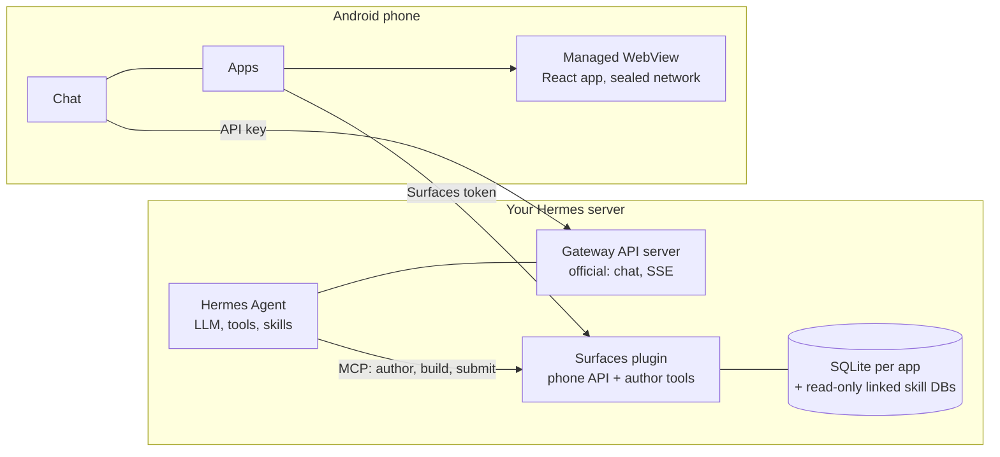

# Hermes Mobile Surfaces

[English](README.md) · [Русский](README.ru.md) · [简体中文](README.zh-CN.md) · **Português (Brasil)** · [한국어](README.ko.md) · [日本語](README.ja.md) · [Español](README.es.md)

Um aplicativo Android para o [Hermes Agent](https://hermes-agent.nousresearch.com/): converse com o seu Hermes e use
**miniaplicativos que o próprio Hermes cria para você**.

Você pede ao Hermes, no chat, uma tela ("uma tela para as minhas contas de consumo"). O Hermes escreve um pequeno
aplicativo React, um plugin no servidor o compila, e o celular o mostra como um aplicativo próprio: abre na hora, funciona
offline a partir de uma cópia salva, lê os seus dados reais e você o refina conversando de novo com o Hermes. Abrir um
aplicativo e trocar filtros não gera nenhuma requisição ao LLM; o modelo só é usado quando um aplicativo é criado ou
alterado. Nada vai ao ar até que você veja uma prévia no celular e a aprove com uma assinatura feita no celular.

- **Chat** com o Hermes pela API Gateway oficial: respostas em fluxo, sessões, voz, anexos e uma notificação quando a
  resposta fica pronta.
- **Apps**: o catálogo dos seus miniaplicativos, prévias para aprovar ou rejeitar, exclusão de aplicativos (guardados por
  30 dias numa lixeira no servidor) e cópias offline que se mantêm atualizadas sozinhas.
- **Tasks**: as suas tarefas cron do Hermes. Criar, pausar, executar e escolher para onde vai o resultado: Telegram, o chat
  de onde ela veio ou lugar nenhum.
- **Sem dependência**: a parte do servidor é um pequeno serviço Python ao lado do seu Hermes. Nada do próprio Hermes é
  modificado.

Estado: funciona de ponta a ponta no celular e no servidor do autor (testado com o Hermes 0.21.x). É uma pré-versão e
ainda não passou por nenhuma revisão de segurança independente: leia [Segurança](#segurança) antes de expor qualquer
coisa à internet.

A tela Apps do aplicativo hoje aparece só em inglês ou russo; este texto cita os nomes dos botões em inglês, como aparecem.

## Como tudo se encaixa



- **Criação.** O Hermes edita o código-fonte de um aplicativo pelas ferramentas do plugin. O plugin faz a verificação e a
  compilação num modelo fixo, com limites de tempo e de memória, e produz um pacote imutável. Quando um celular foi
  pareado como aprovador, publicar é apenas um envio: o celular mostra a compilação como prévia com dados reais e você
  publica ou rejeita com uma assinatura feita no celular.
- **Uso.** O celular baixa o pacote pelo resumo (digest), verifica, instala de forma atômica e o executa a partir de uma
  origem local. A página não consegue fazer requisições de rede por conta própria; ela pede ao aplicativo consultas
  nomeadas, e o aplicativo responde com dados do servidor ou da última cópia salva.

## Instalação

Você precisa de um servidor Linux com systemd 247+, Python 3.11+ com `venv` e `git` onde o Hermes roda; Node.js 20+ se o
Hermes deve compilar telas de interface (`--with-authoring`). Para compilar o aplicativo: Flutter 3.44 (stable), JDK 17 e
Android SDK 36. Siga os passos nesta ordem: o celular precisa estar pareado antes de o Hermes ganhar acesso de escrita
(passo 6).

**Ou peça ao Hermes.** Dê ao Hermes a skill de instalação uma única vez e, depois, peça a ele em um chat neste servidor que instale o Hermes Mobile Surfaces a partir do endereço deste repositório. A skill executa o mesmo instalador dos passos abaixo, mostra o plano, pergunta antes de cada alteração e pareia o telefone antes de deixar o Hermes entrar. Ela não consegue colocar o app no seu telefone (passo 3).

```sh
hermes skills install famfamfam/hermes-miniapps/skills/surfaces-install
```

No chat, o mesmo funciona como `/skills install …`. A skill está em [skills/surfaces-install](skills/surfaces-install/SKILL.md); é curta, leia-a primeiro.

### 1. Servidor

```sh
git clone <this repository> hermes-miniapps && cd hermes-miniapps
python3 tools/install/install.py plan
sudo python3 tools/install/install.py apply --with-authoring --enable --start
```

`plan` mostra todas as alterações e não escreve nada. `apply` cria `/opt/hermes-surfaces` (código, ambiente virtual, as
skills do Hermes), dois tokens aleatórios em `/etc/hermes-surfaces/` (modo 0600) e um serviço systemd reforçado, e registra
a instalação. Ele nunca edita arquivos do próprio Hermes a menos que você passe `--write-hermes-config`, e recusa (sem
alterar nada) quando uma porta está ocupada ou falta um pré-requisito. É necessário um Python do sistema, como
`/usr/bin/python3`; no Debian ou Ubuntu, rode antes `apt install python3-venv`.

| Opção | Efeito |
|---|---|
| `--with-authoring` | Permite que o Hermes compile telas de interface. Exige Node.js 20+; `--copy-node` usa uma cópia privada se o node estiver em `/root` ou `/home`. |
| `--limits small` | Limites de memória e CPU para um servidor pequeno. Com authoring, conte com cerca de 450 MiB de memória livre. |
| `--scope user` | Sem root: arquivos em `~/.local`, `systemctl --user`. Roda com os seus direitos, então prefira o escopo de sistema num servidor. |
| `--write-hermes-config` | Deixa o instalador adicionar as entradas do Hermes do passo 6 (com backups). |
| `--wheelhouse DIR` | Instalação offline a partir de wheels já construídas. |
| `--host ADDR` | Vincula a API do celular a outro endereço. HTTP simples; leia antes [Segurança](#segurança). |

Verifique:

```sh
sudo /opt/hermes-surfaces/venv/bin/python -m mobile_surfaces.install status --health --scope system
```

### 2. Servidor de API do Hermes (para o chat)

O chat conversa com o servidor de API oficial do Hermes, que vem desligado por padrão. No `~/.hermes/.env` do perfil do
Hermes:

```text
API_SERVER_ENABLED=true
API_SERVER_KEY=<your own long random key>
API_SERVER_HOST=127.0.0.1
API_SERVER_PORT=8642
```

Reinicie o gateway do Hermes. A chave é obrigatória mesmo em loopback e deve ser diferente dos tokens do Surfaces. Essa API
alcança **todas as ferramentas do agente, inclusive o terminal**: mantenha-a em loopback e acesse-a por um túnel, uma VPN
ou um endereço HTTPS com chave própria. Detalhes: [Hermes API server](https://hermes-agent.nousresearch.com/docs/user-guide/features/api-server).

### 3. O aplicativo

```sh
cd client
flutter pub get
flutter build apk --release
adb install -r build/app/outputs/flutter-apk/app-release.apk
```

Sem um `client/key.properties`, o APK de release é assinado com a chave de depuração da sua máquina e instala como está.
Para assinar com a sua própria chave, crie `client/key.properties` com `storeFile`, `storePassword`, `keyAlias` e
`keyPassword`. Uma atualização exige o mesmo id de aplicativo (`dev.hermes.hermes_surfaces_example`), a mesma chave e um
número de build maior (`--build-number`).

### 4. Alcançar o servidor pelo celular

Nunca abra as portas do Surfaces ou do Hermes para a internet como estão. Escolha um caminho:

| Caminho | Como |
|---|---|
| USB (para testar) | Encaminhe as duas portas voltadas ao celular; nunca encaminhe a porta do autor, 8788. O aplicativo então usa `http://127.0.0.1:18642` (chat) e `http://127.0.0.1:18787` (Apps). |
| VPN | WireGuard, Tailscale e similares; instale com `--host <endereço da VPN>`. |
| HTTPS no IP do servidor | Sem túnel, VPN nem domínio: nginx com um certificado de IP do Let's Encrypt, um caminho secreto e limite de taxa. Receita: [tools/edge](tools/edge/README.md). |

```sh
ssh -N -L 127.0.0.1:18642:127.0.0.1:8642 <user>@<server>
ssh -N -L 127.0.0.1:18787:127.0.0.1:8787 <user>@<server>
adb reverse tcp:18642 tcp:18642
adb reverse tcp:18787 tcp:18787
```

No aplicativo, adicione o seu Hermes: o endereço do Gateway e a chave de API do passo 2. Envie uma mensagem curta para
confirmar que o chat funciona.

### 5. Parear o celular

A tela Apps se conecta com uma **linha de conexão** (`HAP1.…`): o endereço da API do celular mais um código de uso único,
válido por 15 minutos e utilizável uma vez. Ela não é o token. O celular a troca pelo token e se registra como o
dispositivo que confirma a publicação e a exclusão de aplicativos. O primeiro celular a parear vira o aprovador, e enquanto
nenhum estiver pareado o `app_publish` de um agente publica sem revisão; por isso faça isto **antes** do passo 6.

Escreva o endereço que o celular usa e peça um código:

```sh
sudo sh -c 'umask 077; echo "<address the phone uses>" > /etc/hermes-surfaces/public-url'
sudo /opt/hermes-surfaces/venv/bin/python -I -m ms_admin pair-code --token-file /etc/hermes-surfaces/api-token
```

O endereço é `http://127.0.0.1:18787` pelo túnel USB acima, ou `https://<host>:<port>/<secret>/ms` para a receita HTTPS
(sem `/api/...` no fim). Copie a linha `HAP1.` impressa para o celular, abra **Apps → Paste connection code** e confirme
"Connect to *host*?". A área de transferência só é lida quando você toca no botão. Para verificar que o celular está
pareado, a resposta de health da API do celular deve dizer `"approverPaired": true`:

```sh
curl -s -H "Authorization: Bearer $(sudo cat /etc/hermes-surfaces/api-token)" http://127.0.0.1:8787/api/plugins/mobile-surfaces/v1/health
```

Quando o Hermes estiver conectado (passo 6), você também pode simplesmente dizer a ele "connect the phone app" e ele
mesmo envia a linha (usa a skill `surfaces-connect-phone`).

Um código não substitui um aprovador que já está pareado. Substituí-lo (celular perdido) é uma ação de administrador,
`ms_admin approvers --clear`, seguida de um novo código.

### 6. Conectar o Hermes ao Surfaces

Adicione ao `~/.hermes/config.yaml`:

```yaml
mcp_servers:
  surfaces:
    url: "http://127.0.0.1:8788/mcp"
    trust: untrusted
    timeout: 180
    headers:
      Authorization: "Bearer ${MOBILE_SURFACES_MCP_TOKEN}"
skills:
  external_dirs:
    - /opt/hermes-surfaces/skills
```

Coloque o token no `~/.hermes/.env` sem imprimi-lo, depois rode `/reload-mcp` num chat do Hermes e inicie uma nova
sessão:

```sh
umask 077 && printf 'MOBILE_SURFACES_MCP_TOKEN=%s\n' "$(sudo cat /etc/hermes-surfaces/mcp-token)" >> ~/.hermes/.env
```

Se o seu Hermes não expandir `${...}` nos cabeçalhos (você recebe 401), instale com `--hermes-token-mode inline`. Em vez
de editar à mão, você pode passar `--write-hermes-config` ao `apply`: ele faz backup de cada arquivo antes, marca a sua
entrada e nunca sobrescreve uma entrada que não criou.

`trust: untrusted` faz o Hermes pedir a sua confirmação para cada escrita que o plugin faz (criar um arquivo, compilar,
publicar): muitas perguntas para um só aplicativo. `trust: full` as remove; com um celular pareado, publicar e excluir
um aplicativo ainda exigem a assinatura desse celular. Qualquer que seja a escolha, mantenha o `approvals.timeout` do
Hermes no padrão de 300 segundos: uma resposta que chega depois recebe HTTP 409 e o aplicativo avisa que a confirmação
expirou.

### 7. Criar um aplicativo

Peça ao Hermes no chat: "Faça uma tela para as minhas despesas mensais". Quando a compilação terminar, uma prévia aparece
em **Apps → Waiting for your decision**: abra-a com dados reais e então publique ou rejeite. Peça alterações do mesmo
jeito. Para excluir um aplicativo use ⋮ → Delete app: ele vai para a lixeira do servidor por 30 dias (`ms_admin trash`,
`ms_admin restore-app <name>`).

## Atualizar e desinstalar

```sh
git pull && python3 tools/install/install.py plan --upgrade
sudo python3 tools/install/install.py apply --upgrade
sudo python3 tools/install/install.py uninstall
sudo python3 tools/install/install.py uninstall --purge --yes
```

`--upgrade` mantém tokens e dados. `uninstall` remove a unit e o código e mantém dados e tokens; `--purge` apaga também os
bancos de dados e os tokens. O Hermes só é alterado com `--write-hermes-config`; caso contrário, apague você mesmo o bloco
`mcp_servers.surfaces` e a linha `MOBILE_SURFACES_MCP_TOKEN`.

## Solução de problemas

| Sintoma | Causa e solução |
|---|---|
| Apps mostra "Surfaces is not set up" | Toque em **Paste connection code** (peça uma linha ao Hermes ou rode `pair-code` antes). O chat não é afetado. |
| "The server rejected the token" | O token está errado ou foi trocado. Peça uma nova linha de conexão. Não é a chave do Gateway. |
| "The code is wrong or has expired" | Uma linha vale uma vez e por 15 minutos. Após cinco tentativas erradas o servidor espera um minuto. |
| "Offline" com um horário antigo | Sem caminho até o servidor (túnel caiu, `adb reverse` perdido). Os aplicativos salvos ainda abrem; o app tenta de novo sozinho. |
| A confirmação expirou (the confirmation expired) | O Hermes parou de esperar (`approvals.timeout`). Peça a ele que repita a ação. |
| Aprovar, rejeitar e excluir estão desativados | Este celular não é o aprovador pareado. |
| `already installed ... --upgrade` | É o esperado. Rode antes `apply --upgrade` ou `uninstall`. |
| `ensurepip is not available` | `apt install python3-venv`. |
| O serviço sai com status 203/EXEC | O serviço em sandbox não consegue executar um Python em `/home` ou `/root`: use `--python /usr/bin/python3`. |
| Hermes: 401 em `hermes mcp test surfaces` | O token no `.env` está desatualizado, ou use `--hermes-token-mode inline`. |
| `INSTALL_FAILED_UPDATE_INCOMPATIBLE` | A chave de assinatura é diferente da do aplicativo instalado. |
| As compilações são mortas | Memória: adicione swap ou memória, ou deixe `--with-authoring` desligado (`journalctl -u hermes-surfaces`). |

## Segurança

- O serviço roda como um usuário transitório sem privilégios: sem diretório pessoal, com o SO somente leitura, `/tmp`
  privado, sem dispositivos nem capacidades; e, ligado ao loopback, não consegue enviar nem receber tráfego de outros
  endereços. Ele só escreve no próprio diretório de estado.
- Há três segredos separados: a chave de API do Hermes (executa as ferramentas do agente, inclusive o terminal), o token do
  celular do Surfaces e o token MCP do autor (escreve dados dos aplicativos e publica). Os tokens existem apenas em
  `/etc/hermes-surfaces/` (modo 0600), nunca na unit, no ambiente, numa linha de comando, nos logs nem na saída do
  instalador. Não coloque um token num APK, num repositório ou num chat.
- Mantenha as três portas em loopback. A receita HTTPS expõe apenas a API Gateway e a API do celular, nunca o MCP do autor.
- A página de um aplicativo roda numa WebView com a rede selada: ela não faz requisições próprias, só pede ao aplicativo
  consultas nomeadas. Os dados que o autor lê são enviados ao seu provedor de modelo.
- O primeiro celular a parear vira o aprovador (confiança no primeiro uso). Um código de conexão é de uso único, vale 15
  minutos e é guardado apenas como resumo (digest). A exclusão de um aplicativo é assinada sobre uma mensagem própria, de
  modo que uma assinatura de publicação não exclui nada, e vice-versa.

Os pontos em aberto conhecidos estão listados em [SECURITY.md](SECURITY.md), junto com a forma de relatar uma
vulnerabilidade.

## Repositório

| Caminho | Conteúdo |
|---|---|
| `client/` | O aplicativo Android (Flutter): chat, tarefas, configurações e a tela Apps |
| `plugin/` | Servidor Python: sandbox SQL, registro, pacotes, compilador, aprovação, instalador, skills do Hermes |
| `packages/hermes_surfaces/` | Núcleo Flutter: verificação de pacotes, host WebView com rede selada, ponte JS, snapshots |
| `packages/hermes_surfaces_bridge/` | A tela Apps e a configuração do Surfaces, utilizável em qualquer app de chat Flutter ([README](packages/hermes_surfaces_bridge/README.md)) |
| `packages/mobile-sdk/`, `templates/` | SDK React e os pontos de partida com que o Hermes cria os aplicativos |
| `tools/` | O instalador, a receita HTTPS e utilitários |
| `third_party/` | O plugin de WebView com a correção de uma linha no Gradle de que o cliente precisa |
| `contracts/` | Dados de teste compartilhados |

Testes: `cd plugin && python -m pytest`, e `flutter test` em `client/`, `packages/hermes_surfaces/` e
`packages/hermes_surfaces_bridge/`. Veja [CONTRIBUTING.md](CONTRIBUTING.md).

## Licença

[MIT](LICENSE). O aplicativo em `client/` partiu de [rusty4444/hermes-android](https://github.com/rusty4444/hermes-android)
(commit `8f0edca2ea98`).
