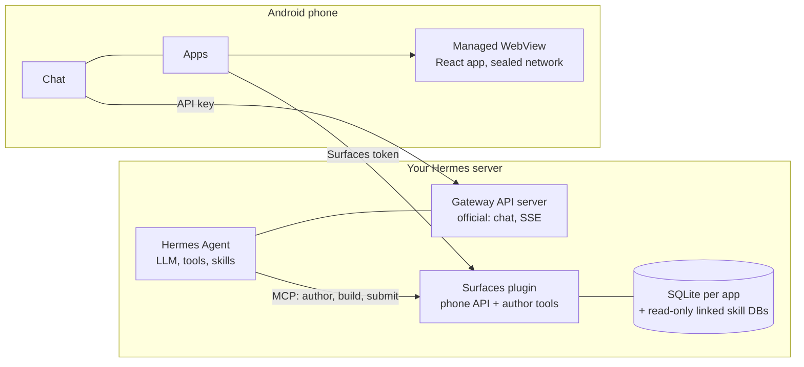

# Hermes Mobile Surfaces

[English](README.md) · **Русский** · [简体中文](README.zh-CN.md) · [Português (Brasil)](README.pt-BR.md) · [한국어](README.ko.md) · [日本語](README.ja.md) · [Español](README.es.md)

Android-приложение для [Hermes Agent](https://hermes-agent.nousresearch.com/): чат с вашим Hermes и **мини-приложения,
которые Hermes строит для вас**.

Вы просите Hermes в чате сделать экран («экран для моих коммунальных счетов»). Hermes пишет небольшое React-приложение,
серверный плагин собирает его, и телефон показывает его как отдельное приложение: оно открывается мгновенно, работает без
сети по сохранённой копии, читает ваши настоящие данные, а доработать его можно, снова попросив Hermes. Открытие
приложения и переключение фильтров не требуют запросов к LLM: модель нужна только при создании или изменении приложения.
Ничего не публикуется, пока вы не увидели предпросмотр на телефоне и не подтвердили его подписью, сделанной на телефоне.

| Обзор | Счета | Новый счёт |
|:---:|:---:|:---:|
|  |  |  |

*Пример мини-приложения (шаблон `react-app` на выдуманных данных). Hermes делает такие экраны по запросу в чате.*

- **Чат** с Hermes через его официальный Gateway API: потоковые ответы, сессии, голос, вложения, уведомление, когда ответ
  готов.
- **Приложения**: каталог ваших мини-приложений, предпросмотры для подтверждения или отклонения, удаление приложения (на
  сервере оно 30 дней лежит в корзине), офлайн-копии, которые обновляются сами.
- **Задачи**: ваши cron-задачи Hermes. Создать, приостановить, запустить и выбрать, куда прислать результат: в Telegram,
  в чат, откуда задача создана, или никуда.
- **Без привязки**: серверная часть — небольшой Python-сервис рядом с вашим Hermes. Сам Hermes не изменяется.

Статус: работает от начала до конца на телефоне и сервере автора (проверено на Hermes 0.21.x). Это предварительная
версия, независимого разбора безопасности не было: прежде чем открывать что-либо в интернет, прочитайте раздел
[Безопасность](#безопасность).

## Как всё устроено



- **Создание.** Hermes правит исходники приложения через инструменты плагина. Плагин проверяет и собирает их в
  фиксированном шаблоне с ограничениями по времени и памяти и получает неизменяемый пакет. Когда телефон спарен как
  подтверждающий, публикация — лишь отправка на рассмотрение: телефон показывает сборку как предпросмотр на настоящих
  данных, а вы публикуете или отклоняете её подписью, сделанной на телефоне.
- **Использование.** Телефон скачивает пакет по хешу, проверяет его, устанавливает атомарно и запускает с локального
  origin. Страница не может делать собственные сетевые запросы: она просит у приложения именованные запросы, а приложение
  отвечает с сервера или из последней сохранённой копии.

## Установка

Нужен Linux-сервер с systemd 247+, Python 3.11+ с `venv` и `git` там, где работает Hermes; Node.js 20+, если Hermes должен
собирать экраны интерфейса (`--with-authoring`). Для сборки приложения: Flutter 3.44 (stable), JDK 17, Android SDK 36.
Выполняйте шаги по порядку: телефон должен быть спарен до того, как Hermes получит доступ на запись (шаг 6).

**Или поручите это Hermes.** Один раз дайте Hermes навык установки и попросите его в чате на этом сервере установить Hermes Mobile Surfaces по адресу этого репозитория. Навык запускает тот же установщик, что и шаги ниже, показывает план, спрашивает перед каждым изменением и сопрягает телефон до того, как пустит Hermes к плагину. Поставить приложение на телефон он не может (шаг 3).

```sh
hermes skills install famfamfam/hermes-miniapps/skills/surfaces-install
```

В чате то же самое работает как `/skills install …`. Навык лежит в [skills/surfaces-install](skills/surfaces-install/SKILL.md): он короткий, прочитайте его сначала.

### 1. Сервер

```sh
git clone <this repository> hermes-miniapps && cd hermes-miniapps
python3 tools/install/install.py plan
sudo python3 tools/install/install.py apply --with-authoring --enable --start
```

`plan` показывает все изменения и ничего не пишет. `apply` создаёт `/opt/hermes-surfaces` (код, виртуальное окружение,
навыки Hermes), два случайных токена в `/etc/hermes-surfaces/` (права 0600) и защищённый systemd-сервис, и записывает
установку. Файлы самого Hermes он не трогает, если не передать `--write-hermes-config`, а при занятом порте или
отсутствующей зависимости отказывается и ничего не меняет. Нужен системный Python вроде `/usr/bin/python3`; в Debian и
Ubuntu сначала `apt install python3-venv`.

| Опция | Что делает |
|---|---|
| `--with-authoring` | Позволяет Hermes собирать экраны интерфейса. Нужен Node.js 20+; `--copy-node` использует отдельную копию node, если он лежит в `/root` или `/home`. |
| `--limits small` | Потолки памяти и процессора для небольшого сервера. С авторингом рассчитывайте примерно на 450 MiB свободной памяти. |
| `--scope user` | Без root: файлы в `~/.local`, `systemctl --user`. Работает с вашими правами, поэтому на сервере лучше системный режим. |
| `--write-hermes-config` | Разрешить установщику добавить записи Hermes из шага 6 (с резервными копиями). |
| `--wheelhouse DIR` | Установка без сети из заранее собранных wheel-пакетов. |
| `--host ADDR` | Привязать API телефона к другому адресу. Обычный HTTP; сначала прочитайте [Безопасность](#безопасность). |

Проверка:

```sh
sudo /opt/hermes-surfaces/venv/bin/python -m mobile_surfaces.install status --health --scope system
```

### 2. API-сервер Hermes (для чата)

Чат работает через официальный API-сервер Hermes, который по умолчанию выключен. В `~/.hermes/.env` профиля Hermes:

```text
API_SERVER_ENABLED=true
API_SERVER_KEY=<your own long random key>
API_SERVER_HOST=127.0.0.1
API_SERVER_PORT=8642
```

Перезапустите шлюз Hermes. Ключ обязателен даже на loopback и должен отличаться от токенов Surfaces. Этот API даёт доступ
к **каждому инструменту агента, включая терминал**: держите его на loopback и подключайтесь через туннель, VPN или
HTTPS-адрес со своим ключом. Подробности: [Hermes API server](https://hermes-agent.nousresearch.com/docs/user-guide/features/api-server).

### 3. Приложение

Самый быстрый способ — подписанный APK со страницы [Releases](https://github.com/famfamfam/hermes-miniapps/releases): откройте его на телефоне (разрешите установку из браузера или файлового менеджера) или поставьте через `adb install -r`. Каждый релиз подписан одним ключом проекта, поэтому следующий ставится поверх предыдущего. Чтобы собрать самому:

```sh
cd client
flutter pub get
flutter build apk --release
adb install -r build/app/outputs/flutter-apk/app-release.apk
```

Без `client/key.properties` релизный APK подписывается отладочным ключом вашего компьютера и устанавливается как есть.
Чтобы подписать своим ключом, создайте `client/key.properties` с `storeFile`, `storePassword`, `keyAlias` и
`keyPassword`. Для обновления нужны тот же идентификатор приложения (`dev.hermes.hermes_surfaces_example`), тот же ключ и
больший номер сборки (`--build-number`).

### 4. Доступ с телефона к серверу

Никогда не открывайте порты Surfaces или Hermes в интернет как есть. Выберите один путь:

| Путь | Как |
|---|---|
| USB (чтобы попробовать) | Пробросьте два порта для телефона; порт автора 8788 не пробрасывайте никогда. Тогда приложение использует `http://127.0.0.1:18642` (чат) и `http://127.0.0.1:18787` (Приложения). |
| VPN | WireGuard, Tailscale и т. п.; установите с `--host <адрес в VPN>`. |
| HTTPS на IP сервера | Без туннеля, VPN и домена: nginx с IP-сертификатом Let's Encrypt, секретным путём и ограничением частоты. Рецепт: [tools/edge](tools/edge/README.md). |

```sh
ssh -N -L 127.0.0.1:18642:127.0.0.1:8642 <user>@<server>
ssh -N -L 127.0.0.1:18787:127.0.0.1:8787 <user>@<server>
adb reverse tcp:18642 tcp:18642
adb reverse tcp:18787 tcp:18787
```

В приложении добавьте свой Hermes: адрес Gateway и API-ключ из шага 2. Отправьте одно короткое сообщение, чтобы
проверить чат.

### 5. Спарить телефон

Экран «Приложения» подключается по **строке подключения** (`HAP1.…`): адрес API телефона плюс одноразовый код, который
действует 15 минут и срабатывает один раз. Это не токен. Телефон меняет её на токен и регистрируется как устройство,
подтверждающее публикацию и удаление приложений. Первый спаренный телефон становится подтверждающим, а пока ни один не
спарен, `app_publish` агента публикует без проверки, поэтому делайте это **до** шага 6.

Запишите адрес, по которому телефон ходит на сервер, и запросите код:

```sh
sudo sh -c 'umask 077; echo "<address the phone uses>" > /etc/hermes-surfaces/public-url'
sudo /opt/hermes-surfaces/venv/bin/python -I -m ms_admin pair-code --token-file /etc/hermes-surfaces/api-token
```

Адрес — `http://127.0.0.1:18787` через USB-туннель выше или `https://<host>:<port>/<secret>/ms` для HTTPS-рецепта (без
`/api/...` в конце). Скопируйте напечатанную строку `HAP1.` на телефон, откройте **Приложения → Вставить код подключения**
и подтвердите «Подключиться к *хост*?». Буфер обмена читается только по нажатию кнопки. Чтобы проверить, что телефон
спарен, ответ health API телефона должен содержать `"approverPaired": true`:

```sh
curl -s -H "Authorization: Bearer $(sudo cat /etc/hermes-surfaces/api-token)" http://127.0.0.1:8787/api/plugins/mobile-surfaces/v1/health
```

Когда Hermes подключён (шаг 6), можно просто написать ему «подключи приложение на телефоне», и он сам пришлёт строку (он
использует навык `surfaces-connect-phone`).

Код не может заменить уже спаренное подтверждающее устройство. Замена (потерянный телефон) — действие администратора,
`ms_admin approvers --clear`, после чего нужен новый код.

### 6. Подключить Hermes к Surfaces

Добавьте в `~/.hermes/config.yaml`:

```yaml
mcp_servers:
  surfaces:
    url: "http://127.0.0.1:8788/mcp"
    trust: untrusted
    timeout: 180
    headers:
      Authorization: "Bearer ${MOBILE_SURFACES_MCP_TOKEN}"
skills:
  external_dirs:
    - /opt/hermes-surfaces/skills
```

Положите токен в `~/.hermes/.env`, не печатая его, затем выполните `/reload-mcp` в чате Hermes и начните новую сессию:

```sh
umask 077 && printf 'MOBILE_SURFACES_MCP_TOKEN=%s\n' "$(sudo cat /etc/hermes-surfaces/mcp-token)" >> ~/.hermes/.env
```

Если ваш Hermes не подставляет `${...}` в заголовки (вы получаете 401), установите с `--hermes-token-mode inline`. Вместо
ручной правки можно передать `--write-hermes-config` в `apply`: он сначала делает копию каждого файла, помечает свою
запись и никогда не перезаписывает запись, которую не создавал.

`trust: untrusted` заставляет Hermes спрашивать подтверждение на каждую запись плагина (создание файла, сборка,
публикация): на одно приложение вопросов много. `trust: full` их убирает; пока телефон спарен, публикация и удаление
приложения всё равно требуют подписи этого телефона. Что бы вы ни выбрали, оставьте `approvals.timeout` Hermes по
умолчанию, 300 секунд: ответ, пришедший позже, получает HTTP 409, и приложение сообщает, что подтверждение устарело.

### 7. Сделать приложение

Попросите Hermes в чате: «Сделай экран для моих ежемесячных расходов». Когда сборка готова, предпросмотр появляется в
**Приложения → Ждут вашего решения**: откройте его на настоящих данных, затем опубликуйте или отклоните. Изменения
заказываются так же. Чтобы удалить приложение, ⋮ → Удалить приложение: оно уходит в корзину сервера на 30 дней
(`ms_admin trash`, `ms_admin restore-app <name>`).

## Обновление и удаление

```sh
git pull && python3 tools/install/install.py plan --upgrade
sudo python3 tools/install/install.py apply --upgrade
sudo python3 tools/install/install.py uninstall
sudo python3 tools/install/install.py uninstall --purge --yes
```

`--upgrade` сохраняет токены и данные. `uninstall` удаляет юнит и код, но оставляет данные и токены; `--purge` удаляет и
базы, и токены. Hermes меняется только с `--write-hermes-config`; иначе удалите блок `mcp_servers.surfaces` и строку
`MOBILE_SURFACES_MCP_TOKEN` сами.

## Если что-то не работает

| Симптом | Причина и что делать |
|---|---|
| «Surfaces не настроены» | Нажмите **Вставить код подключения** (сначала попросите строку у Hermes или выполните `pair-code`). Чат это не затрагивает. |
| «Сервер отклонил токен» | Токен неверный или был заменён. Получите новую строку подключения. Это не ключ Gateway. |
| «Код неверный или устарел» | Строка работает один раз и 15 минут. После пяти неверных попыток сервер ждёт минуту. |
| «Нет связи» со старым временем | Нет пути до сервера (туннель упал, потерян `adb reverse`). Сохранённые приложения открываются, приложение повторяет попытку само. |
| «Подтверждение устарело» | Hermes перестал ждать (`approvals.timeout`). Попросите его повторить действие. |
| Подтвердить, отклонить и удалить недоступны | Этот телефон не является спаренным подтверждающим устройством. |
| `already installed ... --upgrade` | Так и задумано. Сначала `apply --upgrade` или `uninstall`. |
| `ensurepip is not available` | `apt install python3-venv`. |
| Сервис завершается со статусом 203/EXEC | Сервис в песочнице не может запустить Python из `/home` или `/root`: `--python /usr/bin/python3`. |
| Hermes: 401 на `hermes mcp test surfaces` | Токен в `.env` устарел, либо используйте `--hermes-token-mode inline`. |
| `INSTALL_FAILED_UPDATE_INCOMPATIBLE` | Ключ подписи отличается от ключа установленного приложения. |
| Сборки убиваются | Память: добавьте swap или память, либо не используйте `--with-authoring` (`journalctl -u hermes-surfaces`). |

## Безопасность

- Сервис работает от временного непривилегированного пользователя: без домашнего каталога, с ОС только для чтения,
  приватным `/tmp`, без устройств и привилегий, а при привязке к loopback не может ни отправлять, ни принимать трафик с
  других адресов. Писать он может только в собственный каталог состояния.
- Секретов три, и они раздельные: API-ключ Hermes (запускает инструменты агента, включая терминал), токен телефона для
  Surfaces и токен MCP автора (пишет данные приложений и публикует). Токены лежат только в `/etc/hermes-surfaces/`
  (права 0600) и никогда не попадают в юнит, окружение, командную строку, журналы и вывод установщика. Не кладите токен в
  APK, репозиторий или чат.
- Держите три порта на loopback. HTTPS-рецепт открывает только Gateway API и API телефона, но никогда MCP автора.
- Страница приложения работает в WebView с запечатанной сетью: она не делает собственных запросов, а только просит у
  приложения именованные запросы. Данные, которые читает автор, уходят вашему поставщику модели.
- Первый спаренный телефон становится подтверждающим (доверие при первом использовании). Код подключения одноразовый,
  живёт 15 минут и хранится только в виде хеша. Удаление приложения подписывается над отдельным сообщением, поэтому подпись
  публикации не может удалить ничего, а подпись удаления — опубликовать.

Известные открытые вопросы перечислены в [SECURITY.md](SECURITY.md) вместе с тем, как сообщить об уязвимости.

## Репозиторий

| Путь | Содержимое |
|---|---|
| `client/` | Android-приложение (Flutter): чат, задачи, настройки и экран «Приложения» |
| `plugin/` | Python-сервер: песочница SQL, реестр, пакеты, сборщик, подтверждение, установщик, навыки Hermes |
| `packages/hermes_surfaces/` | Ядро на Flutter: проверка пакетов, WebView-хост с запечатанной сетью, JS-мост, снимки |
| `packages/hermes_surfaces_bridge/` | Экран «Приложения» и настройка Surfaces, годится для любого Flutter-чата ([README](packages/hermes_surfaces_bridge/README.md)) |
| `packages/mobile-sdk/`, `templates/` | React SDK и заготовки, из которых Hermes собирает приложения |
| `tools/` | Установщик, HTTPS-рецепт и вспомогательные скрипты |
| `third_party/` | Плагин WebView с однострочной правкой Gradle, нужной клиенту |
| `contracts/` | Общие тестовые данные |

Тесты: `cd plugin && python -m pytest`, а также `flutter test` в `client/`, `packages/hermes_surfaces/` и
`packages/hermes_surfaces_bridge/`. См. [CONTRIBUTING.md](CONTRIBUTING.md).

## Лицензия

[MIT](LICENSE). Приложение в `client/` началось с [rusty4444/hermes-android](https://github.com/rusty4444/hermes-android)
(коммит `8f0edca2ea98`).
