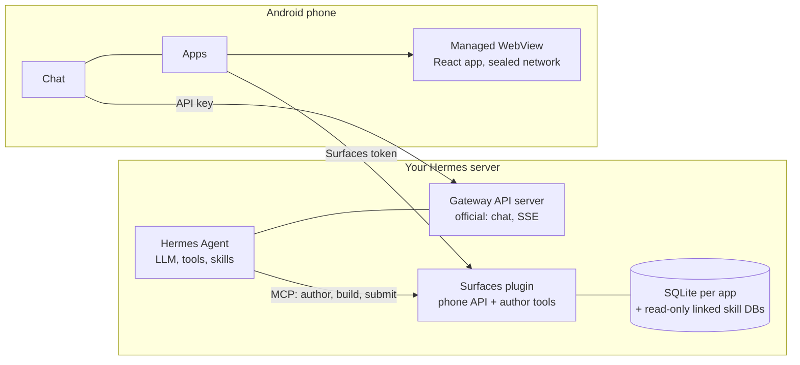

# Hermes Mobile Surfaces

[English](README.md) · [Русский](README.ru.md) · **简体中文** · [Português (Brasil)](README.pt-BR.md) · [한국어](README.ko.md) · [日本語](README.ja.md) · [Español](README.es.md)

一款面向 [Hermes Agent](https://hermes-agent.nousresearch.com/) 的 Android 应用：既能和你的 Hermes 聊天，也有
**由 Hermes 为你制作的小应用**。

你在聊天里让 Hermes 做一个界面（比如“水电燃气账单页面”）。Hermes 写出一个小型 React 应用，服务器插件把它构建好，手机
就把它当作一个独立的应用来显示：秒开，可凭保存的副本离线使用，读取你的真实数据，想改进时再对 Hermes 说一声即可。打开
应用、切换筛选都不会产生 LLM 请求；只有创建或修改应用时才会用到模型。在你于手机上看过预览，并用手机上生成的签名确认之前，
任何内容都不会上线。

- **聊天**：通过 Hermes 官方 Gateway API 与 Hermes 对话，支持流式回复、会话、语音、附件，回答完成时会发通知。
- **应用（Apps）**：你的小应用目录，可批准或拒绝预览，可删除应用（在服务器的回收站里保留 30 天），离线副本会自动保持最新。
- **任务（Tasks）**：你的 Hermes 定时（cron）任务。可新建、暂停、运行，并选择结果发到哪里：Telegram、任务创建时所在的聊天，
  或哪里都不发。
- **无锁定**：服务器部分只是 Hermes 旁边的一个小型 Python 服务，不会修改 Hermes 本身。

状态：已在作者的手机和服务器上完整跑通（针对 Hermes 0.21.x 测试）。这是预发布版本，尚未经过独立的安全审查：在把任何东西
暴露到互联网之前，请先阅读[安全](#安全)一节。

应用里的“Apps”界面目前只有英文和俄文；本文用英文原样标出其中的按钮名称。

## 整体结构



- **制作。** Hermes 通过插件的工具编辑应用的源码。插件在固定的模板中对其进行检查和构建（有时间和内存限制），生成不可变的
  包。当某部手机已配对为审批设备时，“发布”只是提交：手机会用真实数据把这次构建显示为预览，由你用手机上生成的签名发布或拒绝。
- **使用。** 手机按摘要下载包，校验后原子化安装，并从本地 origin 运行。页面自己不能发起网络请求；它向应用索取命名查询，应用
  则从服务器或最近一次保存的副本中作答。

## 安装

你需要在 Hermes 所在的 Linux 服务器上具备 systemd 247+、带 `venv` 的 Python 3.11+ 和 `git`；如果希望 Hermes 构建界面，还需要
Node.js 20+（`--with-authoring`）。构建应用需要 Flutter 3.44（stable）、JDK 17 和 Android SDK 36。请按顺序操作：必须先完成手机
配对，再给 Hermes 写入权限（第 6 步）。

**或者让 Hermes 来做。** 先把安装技能交给 Hermes（只需一次），然后在这台服务器上的聊天里让它根据本仓库的地址安装 Hermes Mobile Surfaces。该技能运行与下面各步骤相同的安装程序，先展示计划，每次更改前都会询问，并在放行 Hermes 之前先配对手机。它无法把应用装到你的手机上（第 3 步）。

```sh
hermes skills install famfamfam/hermes-miniapps/skills/surfaces-install
```

在聊天里同样可以写成 `/skills install …`。技能文件是 [skills/surfaces-install](skills/surfaces-install/SKILL.md)，内容很短，建议先读一遍。

### 1. 服务器

```sh
git clone <this repository> hermes-miniapps && cd hermes-miniapps
python3 tools/install/install.py plan
sudo python3 tools/install/install.py apply --with-authoring --enable --start
```

`plan` 会列出所有改动，不写入任何东西。`apply` 会创建 `/opt/hermes-surfaces`（代码、虚拟环境、Hermes 技能）、位于
`/etc/hermes-surfaces/` 的两个随机令牌（权限 0600）以及一个加固的 systemd 服务，并记录这次安装。除非加上
`--write-hermes-config`，它不会修改 Hermes 自己的文件；端口被占用或缺少依赖时它会拒绝执行并且不做任何改动。需要系统自带的
Python（如 `/usr/bin/python3`）；在 Debian 或 Ubuntu 上先执行 `apt install python3-venv`。

| 选项 | 作用 |
|---|---|
| `--with-authoring` | 让 Hermes 能构建界面。需要 Node.js 20+；如果 node 位于 `/root` 或 `/home` 下，用 `--copy-node` 使用一份私有副本。 |
| `--limits small` | 为小型主机设置内存和 CPU 上限。启用 authoring 时请预留约 450 MiB 的空闲内存。 |
| `--scope user` | 无需 root：文件放在 `~/.local`，使用 `systemctl --user`。它以你自己的权限运行，所以服务器上更推荐系统范围。 |
| `--write-hermes-config` | 让安装程序添加第 6 步的 Hermes 配置项（会先备份）。 |
| `--wheelhouse DIR` | 用预先构建好的 wheel 包离线安装。 |
| `--host ADDR` | 把手机 API 绑定到其他地址。是明文 HTTP；请先阅读[安全](#安全)。 |

检查：

```sh
sudo /opt/hermes-surfaces/venv/bin/python -m mobile_surfaces.install status --health --scope system
```

### 2. Hermes API 服务器（用于聊天）

聊天使用 Hermes 官方的 API 服务器，默认是关闭的。在 Hermes 配置档的 `~/.hermes/.env` 中写入：

```text
API_SERVER_ENABLED=true
API_SERVER_KEY=<your own long random key>
API_SERVER_HOST=127.0.0.1
API_SERVER_PORT=8642
```

重启 Hermes 网关。即使在 loopback 上也必须设置密钥，且必须与 Surfaces 的令牌不同。这个 API 能调用**智能体的所有工具，包括终端**：
请让它只监听 loopback，并通过隧道、VPN 或带有自己密钥的 HTTPS 地址访问。详情见
[Hermes API server](https://hermes-agent.nousresearch.com/docs/user-guide/features/api-server)。

### 3. 应用

```sh
cd client
flutter pub get
flutter build apk --release
adb install -r build/app/outputs/flutter-apk/app-release.apk
```

如果 `client/key.properties` 不存在，发布版 APK 会用你这台机器的调试密钥签名，因此可以直接安装。要用自己的密钥签名，请创建
`client/key.properties`，写入 `storeFile`、`storePassword`、`keyAlias` 和 `keyPassword`。更新应用需要相同的应用 ID
（`dev.hermes.hermes_surfaces_example`）、相同的密钥和更大的构建号（`--build-number`）。

### 4. 让手机连上服务器

切勿把 Surfaces 或 Hermes 的端口原样开放到互联网。请选择一种方式：

| 方式 | 做法 |
|---|---|
| USB（试用） | 转发面向手机的两个端口；永远不要转发作者端口 8788。之后应用使用 `http://127.0.0.1:18642`（聊天）和 `http://127.0.0.1:18787`（Apps）。 |
| VPN | WireGuard、Tailscale 等；安装时加 `--host <VPN 地址>`。 |
| 服务器 IP 上的 HTTPS | 无需隧道、VPN 或域名：nginx 加 Let's Encrypt 的 IP 证书、秘密路径和限速。做法见 [tools/edge](tools/edge/README.md)。 |

```sh
ssh -N -L 127.0.0.1:18642:127.0.0.1:8642 <user>@<server>
ssh -N -L 127.0.0.1:18787:127.0.0.1:8787 <user>@<server>
adb reverse tcp:18642 tcp:18642
adb reverse tcp:18787 tcp:18787
```

在应用里添加你的 Hermes：填入第 2 步的 Gateway 地址和 API 密钥。发一条简短的消息确认聊天正常。

### 5. 配对手机

Apps 界面通过**连接串**（`HAP1.…`）建立连接：它包含手机 API 的地址和一次性代码，有效期 15 分钟，只能使用一次，它不是令牌。
手机用它换取令牌，并把自己注册为负责确认发布和删除应用的设备。第一部配对的手机成为审批设备；在配对之前，智能体的
`app_publish` 会不经审核直接发布，所以请在第 6 步**之前**完成这一步。

写入手机访问服务器所用的地址，然后申请一个代码：

```sh
sudo sh -c 'umask 077; echo "<address the phone uses>" > /etc/hermes-surfaces/public-url'
sudo /opt/hermes-surfaces/venv/bin/python -I -m ms_admin pair-code --token-file /etc/hermes-surfaces/api-token
```

地址：通过上面的 USB 隧道时是 `http://127.0.0.1:18787`；使用 HTTPS 方案时是 `https://<host>:<port>/<secret>/ms`（末尾不要带
`/api/...`）。把打印出的 `HAP1.` 行复制到手机上，打开 **Apps → Paste connection code**，并确认“Connect to *host*?”。只有在你按下
按钮时才会读取剪贴板。要确认手机已配对，手机 API 的 health 响应中必须有 `"approverPaired": true`：

```sh
curl -s -H "Authorization: Bearer $(sudo cat /etc/hermes-surfaces/api-token)" http://127.0.0.1:8787/api/plugins/mobile-surfaces/v1/health
```

Hermes 连接好之后（第 6 步），你也可以直接对它说“connect the phone app”，它会自己把连接串发给你（它使用
`surfaces-connect-phone` 技能）。

代码不能替换已经配对的审批设备。要更换（比如手机丢了），需要管理员执行 `ms_admin approvers --clear`，然后再申请新的代码。

### 6. 让 Hermes 连接 Surfaces

在 `~/.hermes/config.yaml` 中加入：

```yaml
mcp_servers:
  surfaces:
    url: "http://127.0.0.1:8788/mcp"
    trust: untrusted
    timeout: 180
    headers:
      Authorization: "Bearer ${MOBILE_SURFACES_MCP_TOKEN}"
skills:
  external_dirs:
    - /opt/hermes-surfaces/skills
```

把令牌写入 `~/.hermes/.env`（不要打印出来），然后在 Hermes 聊天中执行 `/reload-mcp` 并开始新会话：

```sh
umask 077 && printf 'MOBILE_SURFACES_MCP_TOKEN=%s\n' "$(sudo cat /etc/hermes-surfaces/mcp-token)" >> ~/.hermes/.env
```

如果你的 Hermes 不会展开请求头里的 `${...}`（你会得到 401），请用 `--hermes-token-mode inline` 安装。你也可以不手动编辑，而是给
`apply` 加上 `--write-hermes-config`：它会先备份每个文件，给自己的条目加标记，并且绝不覆盖不是它创建的条目。

`trust: untrusted` 会让 Hermes 对插件的每一次写入（创建文件、构建、发布）都向你确认：做一个应用就会有很多次提问。
`trust: full` 可以去掉这些提问；只要有手机已配对，发布和删除应用仍然需要该手机的签名。无论怎么选，都请让 Hermes 的
`approvals.timeout` 保持默认的 300 秒：更晚的回答会收到 HTTP 409，应用会提示确认已过期。

### 7. 做一个应用

在聊天里对 Hermes 说：“做一个记录我每月开支的页面”。构建完成后，预览会出现在 **Apps → Waiting for your decision**：用真实数据打开它，
然后发布或拒绝。要修改也同样对它说。要删除应用，用 ⋮ → Delete app：它会进入服务器回收站 30 天
（`ms_admin trash`、`ms_admin restore-app <name>`）。

## 升级与卸载

```sh
git pull && python3 tools/install/install.py plan --upgrade
sudo python3 tools/install/install.py apply --upgrade
sudo python3 tools/install/install.py uninstall
sudo python3 tools/install/install.py uninstall --purge --yes
```

`--upgrade` 会保留令牌和数据。`uninstall` 会删除服务单元和代码，但保留数据和令牌；`--purge` 还会删除数据库和令牌。只有加了
`--write-hermes-config` 才会改动 Hermes；否则请自行删除 `mcp_servers.surfaces` 块和 `MOBILE_SURFACES_MCP_TOKEN` 那一行。

## 故障排查

| 现象 | 原因与处理 |
|---|---|
| Apps 提示 “Surfaces is not set up” | 点 **Paste connection code**（先让 Hermes 发一条，或运行 `pair-code`）。聊天不受影响。 |
| “The server rejected the token” | 令牌错误或已被更换。重新获取连接串。它不是 Gateway 密钥。 |
| “The code is wrong or has expired” | 连接串只能用一次，有效期 15 分钟。连续输错五次后服务器会等待一分钟。 |
| “Offline”，时间很旧 | 到服务器的路径不通（隧道断开、`adb reverse` 丢失）。已保存的应用仍可打开；应用会自动重试。 |
| 确认已过期（the confirmation expired） | Hermes 不再等待了（`approvals.timeout`）。让它重新执行该操作。 |
| 批准、拒绝、删除都是灰的 | 这部手机不是已配对的审批设备。 |
| `already installed ... --upgrade` | 这是预期行为。先执行 `apply --upgrade` 或 `uninstall`。 |
| `ensurepip is not available` | `apt install python3-venv`。 |
| 服务以状态 203/EXEC 退出 | 沙箱中的服务无法运行位于 `/home` 或 `/root` 下的 Python：用 `--python /usr/bin/python3`。 |
| Hermes：`hermes mcp test surfaces` 返回 401 | `.env` 里的令牌已过期，或改用 `--hermes-token-mode inline`。 |
| `INSTALL_FAILED_UPDATE_INCOMPATIBLE` | 签名密钥与已安装的应用不同。 |
| 构建被杀掉 | 内存不足：增加 swap 或内存，或不要使用 `--with-authoring`（查看 `journalctl -u hermes-surfaces`）。 |

## 安全

- 服务以临时的非特权用户运行：没有主目录、操作系统只读、私有的 `/tmp`、没有设备和特权；绑定到 loopback 时，既不能向其他地址发送
  流量，也不能接收来自其他地址的流量。它只能写入自己的状态目录。
- 有三个相互独立的机密：Hermes API 密钥（可运行智能体的工具，包括终端）、Surfaces 手机令牌，以及作者 MCP 令牌（写入应用数据并
  发布）。令牌只存放在 `/etc/hermes-surfaces/`（权限 0600），绝不出现在服务单元、环境变量、命令行、日志或安装程序的输出中。不要把令牌
  放进 APK、代码仓库或聊天。
- 让这三个端口保持在 loopback 上。HTTPS 方案只暴露 Gateway API 和手机 API，绝不暴露作者 MCP。
- 应用页面运行在网络被封闭的 WebView 里：它不能自己发起请求，只能向应用索取命名查询。作者读取的数据会发送给你的模型提供商。
- 第一部配对的手机成为审批设备（首次使用即信任）。连接代码只能使用一次，有效期 15 分钟，并且只以摘要形式保存。删除应用是对一条
  单独的消息签名，所以发布签名不能用来删除任何东西，反过来也一样。

已知的未解决问题以及如何报告漏洞，见 [SECURITY.md](SECURITY.md)。

## 仓库结构

| 路径 | 内容 |
|---|---|
| `client/` | Android 应用（Flutter）：聊天、任务、设置和 Apps 界面 |
| `plugin/` | Python 服务器：SQL 沙箱、注册表、包、构建器、审批、安装程序、Hermes 技能 |
| `packages/hermes_surfaces/` | Flutter 核心：包校验、带网络封闭的 WebView 宿主、JS 桥、快照 |
| `packages/hermes_surfaces_bridge/` | Apps 界面和 Surfaces 设置，可用于任何 Flutter 聊天应用（[README](packages/hermes_surfaces_bridge/README.md)） |
| `packages/mobile-sdk/`、`templates/` | React SDK，以及 Hermes 构建应用所用的起始模板 |
| `tools/` | 安装程序、HTTPS 方案和辅助工具 |
| `third_party/` | 带有客户端所需的一行 Gradle 修复的 WebView 插件 |
| `contracts/` | 共用的测试数据 |

测试：`cd plugin && python -m pytest`，以及在 `client/`、`packages/hermes_surfaces/` 和 `packages/hermes_surfaces_bridge/` 中运行
`flutter test`。参见 [CONTRIBUTING.md](CONTRIBUTING.md)。

## 许可证

[MIT](LICENSE)。`client/` 中的应用源自 [rusty4444/hermes-android](https://github.com/rusty4444/hermes-android)
（提交 `8f0edca2ea98`）。
